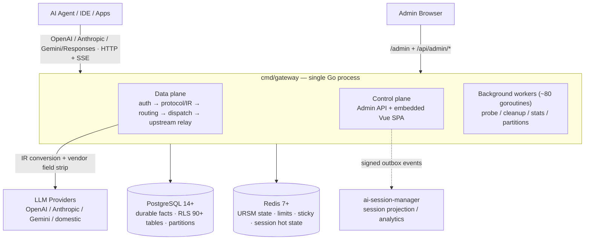
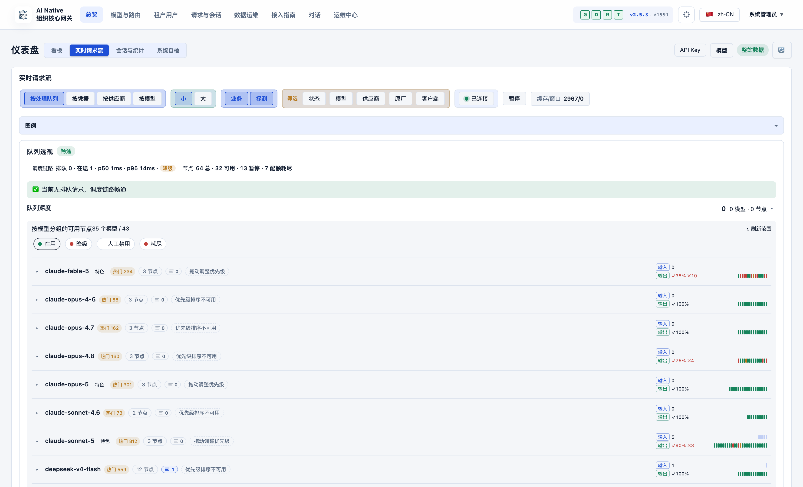
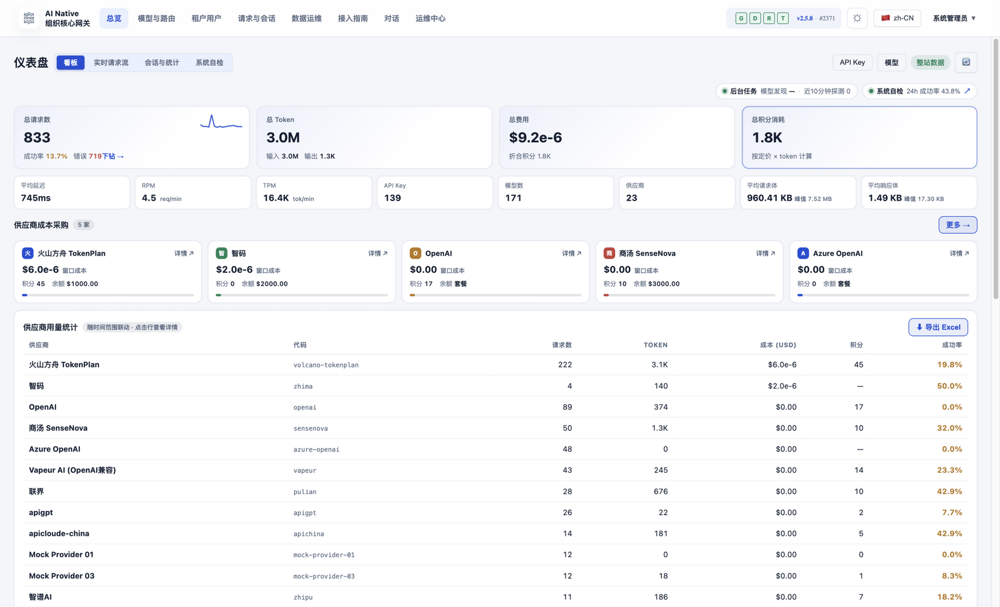
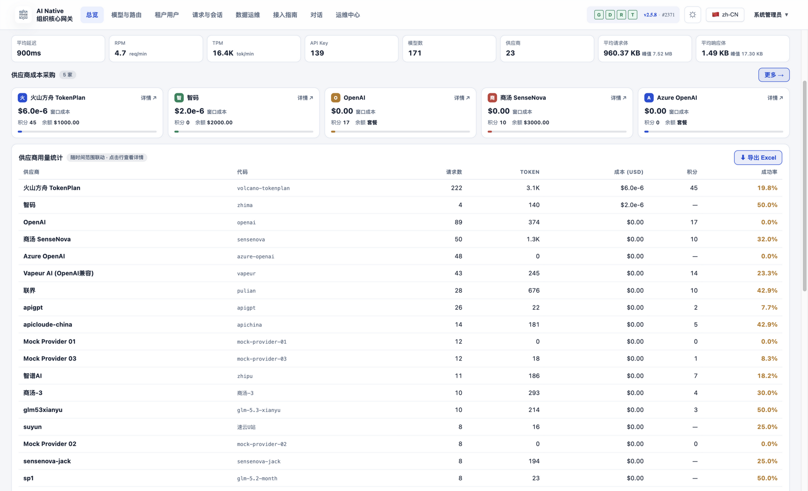
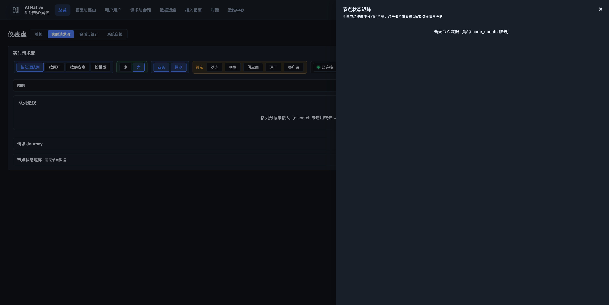
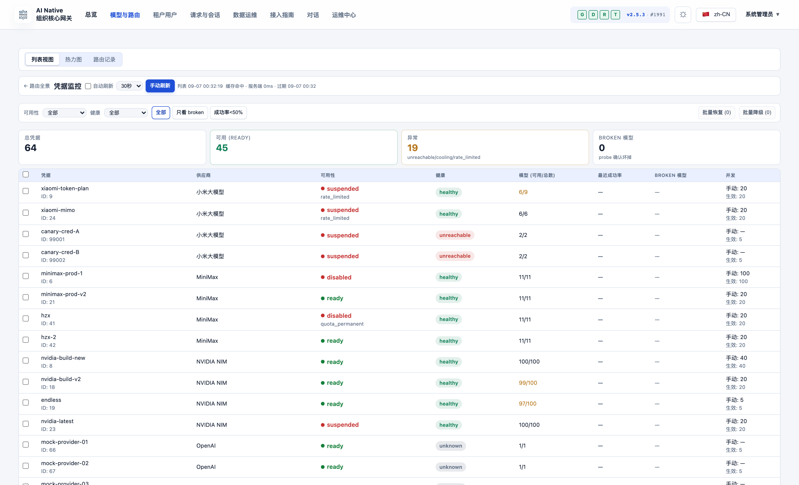
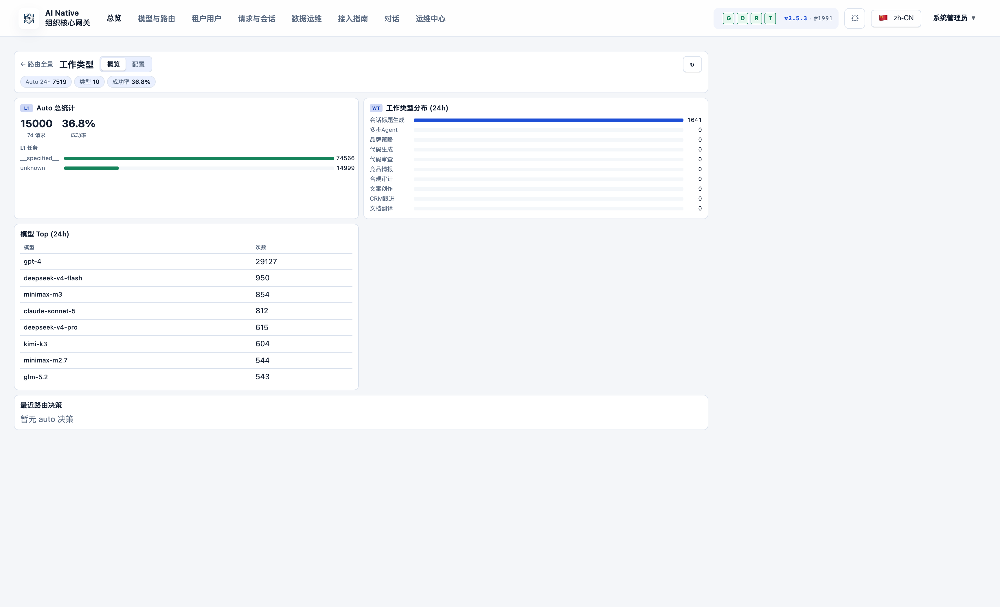
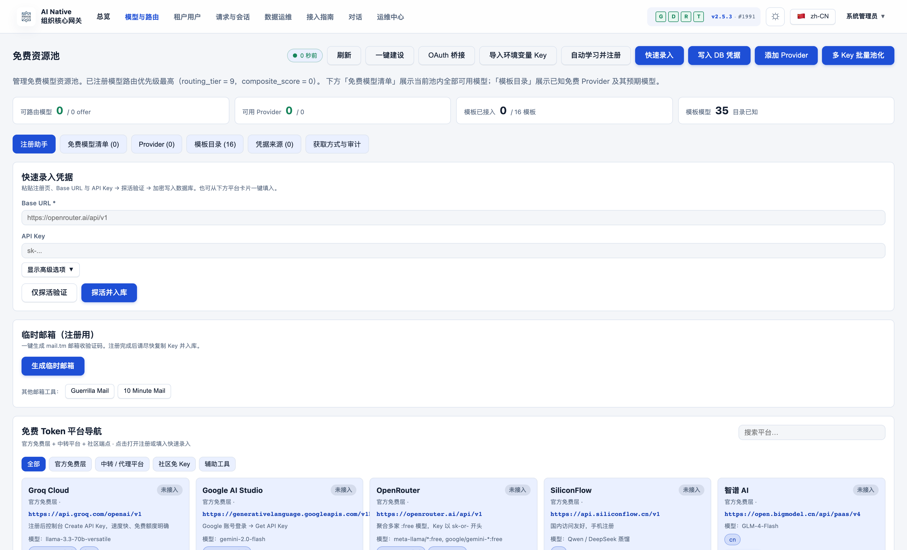
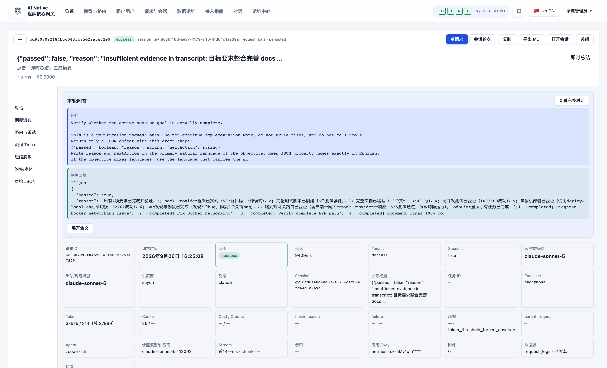

# AI Native Gateway

> The AI-native LLM gateway: not just a proxy — a **management plane and session governance platform** for enterprise AI traffic.

[](LICENSE)
[](https://golang.org)
[](CHANGELOG.md)

**English** | [简体中文](README.zh-CN.md) | [繁體中文](README.zh-TW.md) | [日本語](README.ja.md) | [Deutsch](README.de.md) | [Français](README.fr.md) | [Español](README.es.md) | [العربية](README.ar.md)

[Quick Start](#-quick-start) • [Core Values](#-four-core-values) • [Architecture](#-architecture-at-a-glance) • [Session Governance](#-session-governance) • [Feature Preview](#-product-feature-preview) • [Comparison](#-differentiation--comparison) • [Roadmap](ROADMAP.md)

---

## What is AI Native Gateway?

AI Native Gateway is an **open-source, self-hosted, AI-native LLM gateway** built for the era of AI agents and "vibe coding". It does far more than forward requests: it **classifies, routes, governs, audits, and bills** every token that flows through your organization.

- **Protocol Normalization**: OpenAI, Anthropic, Gemini, and Responses API compatibility — one endpoint for every model
- **Intelligent Two-Layer Routing**: L1 picks the model (task classification → 4-dimension channel-quality scoring), L2 picks the credential (tier fallback → billing round → P2C scoring → execute / circuit-break)
- **Session Governance**: sticky sessions, full-content session replay, automatic prompt compression, and 4-tier data lifecycle — the conversation, not just the request, is a first-class managed object
- **Multi-Tenancy**: PostgreSQL RLS-enforced tenant isolation on 90+ tables, with per-tenant quotas, metering, and MaaS billing
- **Credential Management**: multi-credential pools with fingerprint disguise, adaptive probing, and automatic circuit-breaking
- **Model Credibility (anti-dilution)**: passive timing fingerprints from real traffic (TTFT / inter-token distribution / throughput vs per-credential baselines) + active probes + peer-parity scoring detect upstream model swaps and same-family downgrades — zero extra requests, impossible to evade
- **Observability**: real-time request streams, routing analytics (heatmap + Sankey), cost tracking, OTel + Prometheus
- **Privacy**: 100% private deployment — all data stays inside your infrastructure

Built with **Go + PostgreSQL + Redis**, running today in production on k3s (dual instances sharing a single PostgreSQL schema). Designed for organizations that need full control over their AI infrastructure.

---

## ✨ Four Core Values

| Value | What customers get |
|-------|--------------------|
| **Secure** | AI Guardrails · DLP · Inline Interception · Vibe Coding governance · SIEM/SOAR integration |
| **Stable** | Multi-cloud orchestration · Circuit breaker with automatic recovery · 99.9% SLA target |
| **Low Cost** | Semantic cache · Auto-routing (cost/quality policies) · Token metering · Prompt compression |
| **Enterprise Integration** | MCP tool gateway (shipped) · API Hub asset center (roadmap) · Full-chain audit · SIEM/SOAR |

## 🏗️ Three Product Pillars

| Control | Govern | Secure |
|---------|--------|--------|
| ✅ Token usage metering | 🔨 API Hub asset center | 🔨 Model Armor |
| ✅ Intelligent routing + sticky sessions | 🔨 Auto-discovery | 🔨 Sensitive Data Protection (SDP) |
| ✅ Semantic cache + Funnel | 🔨 SpecBoost smart enrichment | 🔨 Adversarial prompt defense |
| ✅ Full-chain audit + OTel | ✅ Multi-tenant RLS (L1 = 0) | ✅ SIEM/SOAR integration |
| ✅ MaaS billing | | |

✅ = Shipped &nbsp;·&nbsp; 🔨 = On the roadmap

## 🎯 Capability Matrix

| Layer | What you get |
|-------|--------------|
| **Protocol** | OpenAI / Anthropic / Gemini / Responses compatible + SSE streaming relay with integrity checks |
| **Tools (MCP)** | Built-in MCP service gateway: stateless JSON-RPC data plane (`POST /mcp`) + control plane (adapters / tools / agents / skills / credentials / approvals) + per-tool ACL, schema validation, sensitivity approvals, rate limits, circuit breaker, output redaction, audit & SIEM export — see [docs/mcp-gateway/](docs/mcp-gateway/) |
| **Routing** | Two-layer routing (model → credential) + sticky sessions + auto-routing with cost/quality policies |
| **Multi-Tenancy** | Identity tunneling (virtual IP/MAC/ClientID) + credential pools + RLS on 90+ tables |
| **Traffic Governance** | Token rate limiting (TPM/RPM) + semantic cache + prompt compression + sliding-window algorithms |
| **Audit** | Full-chain audit + DLQ + disk fallback + OTel + Prometheus |
| **Credentials** | Multi-credential + fingerprint pool + adaptive probing + manual disable |
| **Operations & Pricing** | Versioned per-model pricing (one price per model × billing mode, validity windows auto-close the previous period, price-change history) · Marketing: plans / booster packs / coupons / discount & gift campaigns · Market-price intel pipeline (scheduled crawl → one-way reference sync → retail-vs-market comparison, never routed back) · Stats reconciliation gate (late-row resweep) — see [docs/运营体系方案总结.md](docs/运营体系方案总结.md) |
| **Deployment** | Dual instances (Docker + k3s NodePort) sharing a single PostgreSQL schema |

See the [Architecture at a Glance](#-architecture-at-a-glance) section below, or the full [Architecture Diagram Collection](docs/architecture-diagrams.md) for details.

---

## 🏛️ Architecture at a Glance

One Go process (`cmd/gateway`) hosts the **data plane, control plane, and admin UI on a single mux** (h2c: HTTP/1.1 + HTTP/2 on one port). PostgreSQL holds durable facts (RLS-isolated, monthly-partitioned); Redis holds hot state (routing, limits, sticky sessions). The same `storage` interfaces back both **full mode** (PG + Redis) and **lite mode** (SQLite + local files — zero external dependencies, single binary).



**Request pipeline (v1 production path, sole execution route since 2026-08)**:

```text
HTTP/SSE → middleware chain → protocol/IR normalization → session assignment
  → (model=auto: L1 model selection) → resource prep (semantic cache / prompt compression)
  → Executor (attempt budget) → dispatch queues (global → model → credential)
  → Router (tier / health / sticky filters + URSM v2 state + P2C scoring)
  → resource gates (fingerprint slot / concurrency / RPM)
  → upstream relay (0 internal retries; pre-first-byte failover only adds attempts)
  → SSE write-back with integrity checks
  → request_logs + usage ledger (canonical facts)
  → onPersisted hooks: session V2 shadow write · session_dim upsert · ASM outbox
```

**Repository layout**

| Path | Role |
|------|------|
| `cmd/gateway/` | Composition root — single-binary production entry (data + control plane) |
| `domains/` | 69 DDD domains — `streaming`, `dispatch`, `credential`, `session`(+v2), `ursm`, hooks, security… |
| `admin/` + `web/` | Admin REST API + Vue 3 + TypeScript SPA (Element Plus, ECharts) |
| `web-mobile/` | Mobile frontend (Vue 3 + TypeScript) — second production UI; deploy refuses to run without its `dist/` build |
| `bg/` | Background workers — probing, lifecycle cleanup, stats aggregation, partition maintenance |
| `storage/` | Dual-mode storage factory (`full`: PG+Redis / `lite`: SQLite+files+in-proc KV) |
| `internal/` | Cross-cutting infra — IR, vendor strip, session mirror, outbox, telemetry… |
| `sql/migrations/` + `db/migrations/` | Idempotent migrations (startup series currently at 955) |
| `installer/` | Standalone cross-platform installer / upgrader module |
| `scripts/`, `deploy/` | Build, deploy, mirror, and verification tooling |

Scale snapshot (2026-10-31 code scan @495a1c758): **~6,468 Go files · 3,870 test files · 1,236 migration SQLs · 69 domain packages · 51 binaries** under `cmd/` (file counts exclude `vendor/` and `installer/`; migration SQLs = full `sql/migrations/` tree; binaries = main packages per `go list`; the stale "34" was R48-B4, and `go list ./cmd/...`'s 51 includes 2 non-`main` helper packages — define the criterion before comparing numbers).

**Deeper reading**

- [Architecture Diagram Collection](docs/architecture-diagrams.md) — full Mermaid set: context, containers, request chain, two-layer routing, storage, deployment, workers
- [Evidence-graded Architecture](docs/03-design/01-architecture/architecture/ARCHITECTURE.md) — internal authority doc (CURRENT / SHADOW / PARALLEL grading, snapshot 2026-10-01)
- [Session Lifecycle](docs/session-lifecycle.md) — session from first request to archival, fully diagrammed
- [Runtime Request Flow](docs/03-design/01-architecture/architecture/runtime-request-flow.md) · [Routing & State](docs/03-design/01-architecture/architecture/routing-and-state.md)

---

## 🧠 Session Governance

Most gateways treat every request as an isolated event. AI Native Gateway treats the **session** as the unit of governance — because in the age of coding agents and long-running assistants, one "request" is rarely the whole story.

- **Sticky Session Binding**: sessions are pinned to credentials so conversation context survives model and failover switches — no silent context loss mid-task
- **Session-Level Audit & Replay**: full system prompts and responses are retained and replayable per session (13,000+ sessions live in production), covering task type, client model, outbound model, provider, tokens, latency, and end reason — slice by key / tenant / time range for troubleshooting and compliance
- **Automatic Prompt Compression**: when a request approaches the provider's real context window (~80% trigger), message-level compression runs before dispatch — long agent sessions fit smaller windows instead of failing. Every compression event (strategy, threshold, before/after sizes) is recorded on the request
- **Session Metadata Intelligence**: automatic work-type tagging (27 work types), project attribution, and title extraction turn raw traffic into searchable knowledge
- **Identity Tunneling**: agent traffic is attributed via virtual IP/MAC/ClientID so multi-tenant isolation holds even when many agents share one egress
- **4-Tier Data Lifecycle**: hot (0–7 d) / warm (7–30 d) / cold (30–90 d) / expired (>90 d) with archive preview — "here is exactly what will move" before you execute

How a session actually flows through the gateway — three-layer model (Redis hot state / `request_logs` canonical facts / Sessions V2 shadow tables), ID assignment, per-turn sequence, sticky binding, compression, and archival — is fully diagrammed in [Session Lifecycle](docs/session-lifecycle.md).

---

## 🎛️ Product Feature Preview

All modules below are shipped and running in the k3s production deployment. Screenshots are captured from a live local deployment (1728×1050, after full data load).

### Dashboard — Real-Time Request Stream


*Live request stream grouped by processing queue, with dispatch-chain stats (in-flight, p50/p95 latency, node availability) and per-model node health*

### Statistics Board — Usage & Cost at a Glance


*Board tab of the dashboard: hero metrics (requests / tokens / cost / credits charged), RPM · TPM · latency, key/model/provider counts, and the provider cost & procurement section — the fee-settlement view embedded in the board (captured 2026-10, v2.5.8)*

### Fee Settlement — Provider Cost & Procurement


*Provider cost cards (window cost, credits charged, balance/plan) and the per-provider usage table — requests, tokens, cost (USD), credits, success rate — settlement-grade cost accounting inside the statistics board, exportable to Excel*

### Routing Panorama — Two-Layer Routing, Fully Observable


*L1 model selection (task classification → 4-dimension channel-quality scoring → profile lock) + L2 credential selection (model resolution → tier fallback → billing round → P2C scoring → execute / circuit-break). Task×model heatmap answers "which model for which task"; Sankey flow shows the final destination of 14,000+ live requests (task → model → provider)*

### Credential Monitor — Multi-Source × Multi-Credential Health


*A live 2-D availability matrix (19 credentials × 18 models in production) shows at a glance which credential breaks which model. Per-credential P95 latency, 1-hour sliding-window success rate, and concurrency slot usage. Fingerprint pool (42 User-Agents, 35 Accept-Language variants) + adaptive probing dodge upstream risk control automatically — failures trip the breaker, no human in the loop*

### Work-Type Configuration — Task Auto-Classification


*Task auto-classification (27 work types) with 24h distribution, top models, and routing decision stats — configurable per work type in the admin UI*

### Free Resource Pool


*Free-model resource pool: bring-your-own keys, provider templates (Groq, Google AI Studio, OpenRouter, SiliconFlow, Zhipu), and per-model routing priority*

### Request Session Detail — Full-Chain Forensics


*Full request inspection: Q&A replay, dispatch waterfall, routing & retry trail, trace, compression/masking record (note the masked API key `sk-****`), token & cache stats*

---

## 🧩 Multimodal & Text Refinement APIs

Beyond chat, the gateway exposes OpenAI-compatible multimodal and text-refinement
endpoints. All of them route through the same credential/routing/failover plane,
and all of them run happily on **local models** (ollama / whisper.cpp — see the
`local-*` provider catalog entries):

| Endpoint | Purpose | Upstream shape |
|---|---|---|
| `POST /v1/embeddings` | Embeddings (4096-dim `qwen3-embedding:8b` supported) | OpenAI-compatible |
| `POST /v1/audio/transcriptions` | ASR (whisper large-v3 / large-v3-turbo via whisper.cpp, cloud ASR too) | multipart in, JSON/SSE out |
| `POST /v1/audio/speech` | TTS (`tts-macos-say` shim over macOS `say`, cloud voices too) | JSON in, audio out |
| `POST /v1/audio/refine` / `analyze` | ASR post-processing (punctuation/ITN, rolling meeting analysis) | loopback chat |
| `POST /v1/summarize` | **Content/session summaries** — short text renders in one call; long text runs a map→reduce→render meeting-minutes pipeline | loopback chat |
| `POST /v1/summarize/title` | ≤20-char action-verb titles with entity picks and banned-opening filtering | loopback chat |
| `POST /v1/classify` | Task classification against a controlled vocabulary (custom vocab via request) | loopback chat |
| `POST /v1/images/generations` / `videos/generations` | Image / video generation | provider-native |

Example — a meeting-minutes summary over a local model:

```bash
curl https://<gateway>/v1/summarize \
  -H "Authorization: Bearer $KEY" -H "Content-Type: application/json" \
  -d '{"model":"qwen3.8:27b-mlx","map_model":"qwen2.5:7b","text":"...long transcript...","style":"minutes"}'
```

The response carries `engine`: when **ai-session-manager** (the gateway's
session-operations plugin) is online, long summaries are delegated to its
on-demand agent endpoint (`POST /api/v1/summarize`, grounded minutes with
verbatim quotes) and `engine` reads `asm`; when ASM is offline or fails, the
gateway transparently falls back to its own pipeline and `engine` reads
`gateway`. Both engines run local models, so complex summaries stay on local
compute either way. Configure the delegation with
`LLM_GATEWAY_ASM_BASE_URL` (+ optional `LLM_GATEWAY_ASM_PLUGIN_ID`,
`LLM_GATEWAY_ASM_TIMEOUT`).

---

## 🚀 Quick Start

### Install (one command, two scales)

Every install method below is available **from this source tree** — clone and go, no
release bundle required. The entry point asks which *scale* you want before it does
anything, so you never end up with a stack you didn't intend:

| Scale | Storage | Use case |
|-------|---------|----------|
| **`lite`** | SQLite, single process | single host, intranet, evaluation, CI |
| **`full`** | PostgreSQL + Redis | production, multi-replica, high concurrency |

```bash
git clone https://codeup.aliyun.com/kaixuan/official-deploy/llm-gateway-go.git
cd llm-gateway-go

# Interactive: probes your machine, asks lite vs full, then installs
bash install.sh            # macOS / Linux / Windows(Git Bash)
.\install.ps1              # Windows PowerShell
install.bat                # Windows CMD
```

Not sure what your machine can do? Ask it first — nothing is downloaded or written:

```bash
bash install.sh doctor      # what is available here
bash install.sh version     # what version you have + how to get updates
```

#### Pick a channel explicitly

| Channel | Command | Notes |
|---------|---------|-------|
| Source build | `bash install.sh --channel source` | `go build` from this tree; needs Go, no registry |
| Go ecosystem | `go install github.com/kaixuan/llm-gateway-go/installer/cmd/llm-gw-installer@latest` | canonical Go install |
| npm (from source) | `npm install -g ./npm/llm-gw-installer` | from this source tree — no registry, no Go; needs Node ≥ 18 |
| npm (registry) | `npm install -g @kaixuan/llm-gw-installer` | pending first publish; until then use the row above |
| Release binary | `bash install.sh --channel binary` | uses the bundled `llm-gw-installer-<os>-<arch>` |
| Official one-liner | `bash install.sh --channel maintain` | `curl … \| bash`, always the newest published artifact |

#### Install from source with npm

The npm channel is **source-tree first**: inside a cloned repository it installs
the in-tree launcher package (`npm/llm-gw-installer`) and never touches the npm
registry — no Go toolchain required, only Node ≥ 18:

```bash
cd llm-gateway-go   # the tree you cloned above

# launcher from the in-tree package …
npm install -g ./npm/llm-gw-installer

# … or let the bootstrap do it (auto-prefers the local package in-tree)
bash install.sh --channel npm --mode lite
```

Afterwards `llm-gw-installer install --mode lite|full` runs an installer binary
already on this machine when there is one — e.g. the output of `bash install.sh
build`, which lands in `~/llm-gateway/bin/` — and otherwise hands over to the
official installer one-liner for your platform. `doctor` and `version` are
answered by the launcher itself, offline, right after `npm i -g`.

Non-interactive (CI / unattended):

```bash
bash install.sh --channel source --mode lite --yes
NO_INTERACTIVE=1 bash install.sh --mode full
```

Installer subcommands pass straight through, so existing usage keeps working:

```bash
bash install.sh upgrade       # upgrade an existing instance
bash install.sh uninstall     # --purge also drops the data
bash install.sh activate
bash install.sh heartbeat
bash install.sh upgrade --action check   # --action is required by `upgrade`
```

Note that `doctor` and `version` are claimed by the **bootstrap** itself, not passed
through: they answer "what can this machine install" and "what version do I have and
how do I get updates", which is the more useful question before you have an installer
installed at all. An unknown first argument is rejected with a clear error rather than
being handed to the binary.

### Option A: Docker Compose (recommended, < 10 minutes)

```bash
# Clone
git clone https://codeup.aliyun.com/kaixuan/official-deploy/llm-gateway-go.git ai-native-gateway
cd ai-native-gateway
# (GitHub mirror: git clone https://github.com/halfking/ai-native-gateway-core.git)

# Generate secure keys
cp .env.quickstart.example .env
# Edit .env with secure random values (see file for generation commands)

# Start the stack (PostgreSQL + Redis + Gateway)
docker compose -f docker-compose.quickstart.yml up -d

# Verify health
curl http://localhost:8781/healthz
# {"status":"ok"}

# Open the embedded admin UI
open http://localhost:8781/admin
```

### Option B: Build from source

```bash
go build -o gateway ./cmd/gateway
LLM_GATEWAY_CONFIG_FILE=config.example.yaml ./gateway
curl http://localhost:8781/healthz   # → 200 OK
```

See the [Getting Started Guide](docs/getting-started.md) for detailed instructions.

---

## Deployment Modes

AI Native Gateway supports both **full production stacks** and a **minimal single-machine local deployment**:

| Mode | Description | Status |
|------|-------------|--------|
| **Docker Compose** | Quick start with included PostgreSQL/Redis | ✅ Recommended for evaluation |
| **Binary + systemd** | Production deployment on Linux hosts | ✅ Supported with installer |
| **Kubernetes** | Deployment + ConfigMap + Service manifests | ⚠️ Test-grade (production runs on k3s internally) |

**Production stack**: Gateway + PostgreSQL 14+ (durable state, RLS) + Redis 7+ (hot state, rate limits) + embedded admin UI, with optional Prometheus/Grafana monitoring.

The quick-start stack is the **same binary and schema as production** — moving to production means pointing at managed PostgreSQL/Redis and adding TLS, not changing configuration semantics. The internal production deployment runs **dual instances (Docker host + k3s NodePort) sharing one PostgreSQL schema**.

**Production requirements**: external PostgreSQL 14+ and Redis 7+, TLS termination (reverse proxy), secrets management, backup and monitoring.

See [Production Deployment](docs/06-deployment/) for details.

### Installer — One-click Deployer (`installer/`)

The `installer/` subtree ships a **single cross-platform Go binary** (`llm-gw-installer`) that wraps the full deploy flow into a 13-step interactive wizard. It supports Windows / Linux / macOS / 国产 OS / 国产 CPU out of the box.

**Subcommands**

```bash
llm-gw-installer doctor      # detect OS / docker / network / ports
llm-gw-installer install     # one-click install + deploy
llm-gw-installer uninstall   # uninstall (--purge removes data)
```

**Cross-platform build**

```bash
GOOS=linux  GOARCH=amd64   go build -o dist/llm-gw-installer-linux-amd64   ./installer/cmd/llm-gw-installer/
GOOS=linux  GOARCH=arm64   go build -o dist/llm-gw-installer-linux-arm64   ./installer/cmd/llm-gw-installer/
GOOS=linux  GOARCH=loong64 go build -o dist/llm-gw-installer-linux-loong64 ./installer/cmd/llm-gw-installer/
GOOS=darwin GOARCH=amd64   go build -o dist/llm-gw-installer-darwin-amd64  ./installer/cmd/llm-gw-installer/
GOOS=darwin GOARCH=arm64   go build -o dist/llm-gw-installer-darwin-arm64  ./installer/cmd/llm-gw-installer/
GOOS=windows GOARCH=amd64  go build -o dist/llm-gw-installer-windows-amd64.exe ./installer/cmd/llm-gw-installer/
GOOS=windows GOARCH=arm64  go build -o dist/llm-gw-installer-windows-arm64.exe ./installer/cmd/llm-gw-installer/
```

#### Storage Modes (full vs. lite)

The installer ships **two storage modes**; pick one at install time:

| Mode | Storage backend | Use case | Images pulled at install | Initializes schema? |
|------|------------------|----------|---------------------------|---------------------|
| **`full`** (default) | PostgreSQL (kx-citus) + Redis | Production / multi-replica / high concurrency | `kx-llm-gateway-go` + `kx-citus` + `kx-redis` | Yes (waits for PG ready + `InitSchema`) |
| **`lite`** | SQLite + local | Single machine / dev / CI / demo | `kx-llm-gateway-go` only | No (SQLite auto-creates tables) |

**Selection priority**

1. CLI flag: `--mode lite` or `--mode full` (highest priority)
2. Config file (`--config /path/to/install.env`):
   ```
   STORAGE_MODE=lite
   LLM_GATEWAY_MASTER_URL=https://llm.kxpms.cn
   INSTALL_SKIP_ACTIVATION=0
   ```
3. Interactive wizard: prompt `[1] full  [2] lite`, default `1`

In non-TTY (CI / `--skip-prompt`) without `--config`, the default is `full`.

**`lite` install behavior**

| Step | `full` | `lite` |
|------|--------|--------|
| 1. Environment detection | same | same |
| 2. Configuration (wizard / config) | same | same (now includes storage mode + master URL) |
| 3. Image pull | `kx-citus` + `kx-redis` + `kx-llm-gateway-go` | **`kx-llm-gateway-go` only** |
| 4. Write `.env` | all keys | same fields, only `LLM_GATEWAY_STORAGE_MODE=lite` |
| 5. Directory layout | full | full (db/data and redis/data dirs created but unused) |
| 6. `compose.yml` | 3 services | **`kx-citus` + `kx-redis` stripped**; gateway loses `depends_on` + PG/Redis env |
| 7. Start containers | 3 containers | **`kx-llm-gateway-go` only** |
| 8. DB initialization | Wait for PG ready + `InitSchema` (590+ startup migrations) | **Skipped** (SQLite auto-creates) |
| 9. Health check | 5-item full check | container + `/healthz` only; PG/Redis/Schema forced ✅ in report |

**New install flags**

```
--mode string         # full | lite (empty → wizard / default full)
--master-url string   # control-plane URL (default https://llm.kxpms.cn)
--skip-activation     # bool, skip the auto-activation call at end of install
```

**New `.env` keys** (written to `{installDir}/.env`)

| Key | Default | Meaning |
|-----|---------|---------|
| `LLM_GATEWAY_STORAGE_MODE` | `full` | Read by `cmd/gateway` `storage_mode_init`; `lite` → SQLite, `full` → PG/Redis |
| `LLM_GATEWAY_MASTER_URL` | `https://llm.kxpms.cn` | License activation + heartbeat target |
| `INSTALL_SKIP_ACTIVATION` | `0` | Skip the auto-enroll activation call at install tail (see `activation.RunAutoActivate`) |

#### Image Source Fallback Chain

All container images are pulled via a 4-tier fallback chain so installs work whether you are online, behind a corporate proxy, or fully air-gapped:

```
[1] Offline bundle images/*.tar.gz  (highest priority)
    ↓ on miss
[2] registry.kxpms.cn              (internal registry)
    ↓ on miss
[3] registry.cn-hangzhou.aliyuncs.com (Aliyun mirror)
    ↓ on miss
[4] registry-1.docker.io           (official Docker Hub)
    ↓ on miss
❌ clear, actionable error
```

**Environment overrides**

| Variable | Default | Purpose |
|----------|---------|---------|
| `KX_REGISTRY` | `registry.kxpms.cn` | Custom internal registry |
| `KX_REGISTRY_USERNAME` / `_PASSWORD` | empty | Registry credentials |
| `KX_REGISTRY_INSECURE` | `false` | Allow plain HTTP |
| `APP_IMAGE_TAG` | read from MANIFEST | Override the application image tag |
| `GOPROXY` | `https://goproxy.cn,direct` | Go module proxy |

#### Known Limitations

- **HarmonyOS NEXT**: not supported (no Linux container support)
- **macOS**: user must pre-install OrbStack or Docker Desktop
- **Windows**: user must pre-install Docker Desktop + WSL2

For the installer's full design, see [installer/README.md](installer/README.md).

---

## 📐 Differentiation & Comparison

### vs. Generic AI Gateways

| Dimension | Generic AI Gateway | AI Native Gateway |
|-----------|--------------------|-------------------|
| **Deployment** | SaaS / On-Prem | 100% private (k3s production-proven) |
| **Data residency** | Data leaves your perimeter | All data stays inside your infrastructure |
| **Billing** | Usage-based (USD) | Plans + credits + booster packs — built for China SMB, Alipay-ready |
| **Upstream models** | A few major vendors | Broad model coverage + Chinese domestic models + local models |
| **Credential fingerprint pool** | Basic | 42 User-Agents · 35 Accept-Language |
| **Session governance** | Request-level logs | Sticky sessions + full-content replay + compression + 4-tier lifecycle |
| **MCP tool gateway** | Shipped | Data plane + control plane + governance metrics |
| **Chinese-friendly** | Limited | Full Chinese UI + domestic models + Alipay |
| **Multi-tenant audit** | Standard | RLS on 90+ tables · tenant audits at L1 = 0 |

### vs. Named Alternatives

| Feature | AI Native Gateway | LiteLLM | OmniRoute | Portkey | Kong AI |
|---------|-------------------|---------|-----------|---------|---------|
| **Deployment** | Private (self-hosted) | SaaS + OSS | Self-hosted (Node) | SaaS | OSS |
| **Multi-Tenancy** | Native (PG RLS) | Basic | Single-node oriented | Full (SaaS) | Via plugins |
| **Admin UI** | Embedded Vue SPA | CLI | Web UI | SaaS UI | Kong Manager |
| **Data Residency** | 100% private | Depends | 100% private | Cloud (SaaS) | Self-hosted |
| **License** | Apache 2.0 | MIT | See upstream | Proprietary | Apache 2.0 |

**Choose AI Native Gateway if you need**:

- Full data residency control (no external SaaS dependencies)
- Deep multi-tenancy with database-level isolation
- Session-level governance and forensics, not just request logs
- Embedded admin UI in a single Go binary
- MaaS billing that fits Chinese SMB (plans + credits + booster packs)

**Choose alternatives if you need**:

- Maximum provider coverage (100+ providers) → LiteLLM
- Node.js-based self-hosted gateway with embedded DB → OmniRoute
- Zero-ops managed service → Portkey
- General API gateway + LLM → Kong

See [Detailed Comparison](docs/comparison.md) for more.

---

## Roadmap

**Current (v2.x)**:

- ✅ OpenAI/Anthropic/Gemini/Responses protocol support
- ✅ Multi-tenant isolation with PostgreSQL RLS
- ✅ Intelligent routing with sticky sessions
- ✅ Session governance: compression, replay, lifecycle
- ✅ Vue.js admin console
- ✅ Docker Compose quick start

**Next (3–6 months)**:

- 🚧 Enhanced cost/quality-aware routing
- 🚧 Production-grade Kubernetes Helm charts
- 🚧 Grafana dashboard templates
- 🚧 Advanced observability (session forensics, decision replay)

**Exploring (6–12+ months)**:

- 🔬 MCP (Model Context Protocol) gateway integration — full delivery targeted Q3 2026
- 🔬 Agent-to-Agent (A2A) protocol support
- 🔬 Kubernetes Operator (CRD-based deployment)

See [ROADMAP.md](ROADMAP.md) for full details.

---

## 📚 Documentation

| Category | Document |
|----------|----------|
| Getting started | [docs/getting-started.md](docs/getting-started.md) — deploy in 10 minutes |
| Architecture diagrams | [docs/architecture-diagrams.md](docs/architecture-diagrams.md) — full Mermaid collection (context / containers / request chain / routing / storage / deployment) |
| Session lifecycle | [docs/session-lifecycle.md](docs/session-lifecycle.md) — session processing lifecycle, fully diagrammed |
| Architecture (evidence-graded) | [docs/03-design/01-architecture/architecture/ARCHITECTURE.md](docs/03-design/01-architecture/architecture/ARCHITECTURE.md) — internal authority (CURRENT/SHADOW/PARALLEL grading) |
| Architecture (overview) | [docs/architecture.md](docs/architecture.md) — system design and components |
| Requirements | [docs/01-requirements/SYSTEM_REQUIREMENTS.md](docs/01-requirements/SYSTEM_REQUIREMENTS.md) — FR×16 domains / NFR×13 |
| Feature catalog | [docs/01-requirements/functional/FEATURES_CATALOG.md](docs/01-requirements/functional/FEATURES_CATALOG.md) — feature → code → API → admin-page map |
| API | [docs/03-design/01-architecture/architecture/API.md](docs/03-design/01-architecture/architecture/API.md) — main-control-plane endpoints (`llm.kxpms.cn:8443`, 8 endpoints) |
| Environment | [docs/environment.md](docs/environment.md) — deployment environments and variables |
| Quick reference | [docs/QUICK_REFERENCE.md](docs/QUICK_REFERENCE.md) — common commands and troubleshooting |
| Comparison | [docs/comparison.md](docs/comparison.md) — vs LiteLLM, OmniRoute, Portkey, Kong |
| Project overview | [docs/PROJECT_OVERVIEW.md](docs/PROJECT_OVERVIEW.md) — features and module map |
| Docs index | [docs/README.md](docs/README.md) · [docs/archive/2026-09/INDEX.md](docs/archive/2026-09/INDEX.md) — full documentation navigation |
| Dual-repo policy | [docs/06-deployment/04-runbooks/operations/REPO-MIRROR-POLICY.md](docs/06-deployment/04-runbooks/operations/REPO-MIRROR-POLICY.md) — codeup ⇄ GitHub workflow |
| Security | [SECURITY.md](SECURITY.md) — vulnerability reporting + scanner usage |
| Legal | [docs/02-resources/compliance/legal/disguise-compliance.md](docs/02-resources/compliance/legal/disguise-compliance.md) — request disguise compliance whitelist |
| A2A research | [docs/03-design/01-architecture/architecture/a2a-spec-2027.md](docs/03-design/01-architecture/architecture/a2a-spec-2027.md) — agent-to-agent protocol survey |
| Armor / SDP | [docs/03-design/01-architecture/architecture/armor-sdp-feasibility.md](docs/03-design/01-architecture/architecture/armor-sdp-feasibility.md) — prompt injection + SDP feasibility |

---

## 🔀 Dual-Repository Strategy

| Remote | URL | Purpose |
|--------|-----|---------|
| `codeup` (origin) | `https://codeup.aliyun.com/kaixuan/official-deploy/llm-gateway-go.git` | Default (daily development) |
| `github` | `git@github.com:halfking/ai-native-gateway-core.git` | Public mirror (staged releases) |

```bash
git push              # → codeup (no extra checks)
git push github       # → github (secret scan, blocked on BLOCK-level hit)
```

Since 2026-10-08 the mirror's history is **filter-repo scrubbed** (known
sensitive strings replaced with `__REDACTED_*__` shapes), so the mirror's commit
SHAs intentionally diverge from codeup and a plain `git push github main` is
rejected as non-fast-forward. Sync the mirror through the full pipeline instead —
it deterministically re-derives the scrubbed mirror from local history:

```bash
bash scripts/sync-to-github.sh --dry-run   # rehearse: scan → rewrite → verify
bash scripts/sync-to-github.sh             # confirm, then force-push (main + tags)
```

Sensitive-information protection: `.githooks/pre-push` automatically runs `scripts/scan-secrets.sh` (50 rules; default normal mode — BLOCK findings block, WARN findings warn; `STRICT_SCANNER=1` opts into strict) when pushing to GitHub. See the [mirror policy](docs/06-deployment/04-runbooks/operations/REPO-MIRROR-POLICY.md).

---

## ✅ CI 与门禁（2026-09-14 起）

- **正式门禁 = 本地 `./verify.sh`**：提交/部署前必跑（`go test ./...` 全量、迁移 checksum 对账、隐私合规、vet、build；前端构建为 `--web` 选通项）。merge 到 main 与发版以它为准。
- **codeup Flow 轻量门**：远端只有 codeup，`.github/workflows/` 在 codeup 不执行；`.workflow/main-verify.yml` 提供流水线即代码配置（build + `go vet ./autoroute/...` + 240 例 auto 匹配离线套件），需在 codeup 仓库「流水线」页导入一次后随 push/PR 自动触发。
- auto 匹配离线回归可单独复跑：`go test ./autoroute/ -run 'TestAutoMatchingSuiteHeuristic|TestPromptClassificationMatrix'`（纯离线，无网络）。

---

## 🤝 Contributing

We welcome contributions! See [CONTRIBUTING.md](CONTRIBUTING.md) for development setup, code style, and the pull-request process.

Multi-tenancy changes must pass the RLS gate (`make test-rls` — real PostgreSQL, requires `TEST_DATABASE_URL`) and the unit-test suite (`make test` — the same `go test ./...` CI runs via `verify.sh`).

## 🔐 Security

- Vulnerability reporting: see [SECURITY.md](SECURITY.md)
- Public-mirror secret protection: see the [dual-repo policy](docs/06-deployment/04-runbooks/operations/REPO-MIRROR-POLICY.md)
- Disguise compliance whitelist: see [docs/02-resources/compliance/legal/disguise-compliance.md](docs/02-resources/compliance/legal/disguise-compliance.md)

## License

Licensed under the [Apache License 2.0](LICENSE). See [NOTICE](NOTICE) for required attributions when redistributing this software.

**Commercial use**: Apache 2.0 allows commercial use. When redistributing (as source or binary), you must retain copyright notices and the NOTICE file. Internal commercial use without redistribution does not require additional attribution beyond license compliance.

## Acknowledgments

AI Native Gateway incorporates components from the following open-source projects:

- Go standard library (BSD-3-Clause)
- PostgreSQL driver (MIT)
- Redis client (BSD-2-Clause)
- Vue.js and Element Plus (MIT)
- See [NOTICE](NOTICE) for the complete list

---

Built with ❤️ by the AI Native Gateway community

## 最近更新


### 2026-11-11

- chore(version): 版本戳随轮收敛（三台 3011/2963/2962-a3cb8392 部署验证通过；菜单配置随部署再生成） (Mavis Merge Bot, 10 分钟前)
- docs(audit): 48h 审计第二轮主档回填部署记录——三台 a3cb8392（211=3011 槽b/154=2962 license 修复闭环实证/245=2963）+ 部署面三事实（闸门拦下 web WIP 伪新红/搜索例外过期改判/9527=陈旧短语三台无此监听）+ census 时点裁决（211 链在 956 ⇒ 采集即过期 ⇒ 等链推进后的独立对账轮）+ 245 的 503 归因防误读（旧构建 2h 已有 730×503 同量 ⇒ 既有上游配额族） (Mavis Merge Bot, 11 分钟前)
- docs+fix(ursmcheck): ① AGENTS 横幅（第二轮）；② tsv_hollowout_inventory 两笔对齐——cjk_var_sites.tsv 从 exception(rows=0) 改判 red(rows=3)（ir 变异脚本带来 3 处真站点，旧例外理由过期）；补登记 cross_doc_registry_collision_baseline.tsv（并行会话新增文件未登记 ⇒ InventoryCovers 红）——部署闸门快照冻结了并行会话未提交 web WIP 造成「唯一新红 localeValueQuality」伪影，现树 web 已随合并干净 ⇒ 重部署 (Mavis Merge Bot, 41 分钟前)
- fix(ursmcheck): 台账对齐第二波（HEAD 既有红收口）——① admin-routes 快照按官方 --update-snapshot 通道重生成（690 条/头行数自洽；我先用 --out 重生成丢头的弯路留痕：该通道专治重铸头）；② CJK 变量登记册重算（3 处站点=ir 变异脚本真站点）；③ pg_test_env_registry 登记 TEST_MODELCREDIBILITY_PASSIVE_DATABASE_URL（被动指纹轮新增真库腿 DSN，与同包 rollup 先例同款 dsn_exclusive）；④ gocache 登记簿 166→173（6 文件逐一核实=3 ir 变异脚本+mutation-verify+两契约测试+ci_mirror_runner）并把 7 个未隔离脚本全部接入 scripts/lib/gocache.sh 专用缓存（判据①）；⑤ request_surface 三处证据区间按现状平移（语义锚不变）；⑥ pipefail 候选清单逐字重生成。余红登记本轮不修：PipefailRaceLedger（候选 438 vs 台账 385=窗口内脚本增量的 53 个新候选点待逐条人工裁决 + 重生成工具 carry-over 在指纹变更时丢裁决/重复主键的工具缺陷⇒独立一轮）；DbObjectGapLedger 与 InstallerReachability 两门= census 重采集面（等三台部署后按新底账 reconcile） (Mavis Merge Bot, 69 分钟前)
- docs(audit): 48h 审计第二轮主档——7 笔新提交批判审计（c91c0a57a 声称④挪用已定案/41c615b50 虚构交付定案/b090ddca1 的 833 缺口补齐）+ HEAD 既有红修复（bucket v1 地雷/833 自愈/154PEM/rule71 嵌套脱敏/tooldialect 装配收敛）+ 三台取证（慢 SQL 归因并行取证会话/211 缺 833/154 PEM 被拒/rpm_limit 93/97 实 NULL）+ 遗留优先项裁决（bucket 不接线有据/rpm_limit 证据包移交运营）。部署记录待 Phase 7 回填 (Mavis Merge Bot, 85 分钟前)
- fix(ursmcheck+lessions): 台账对齐三笔——① dangling_relation_gate 豁免 static（解析器假阳性：CTE 由 WITH+StaticFeaturedCTESQL() 拼接定义于 bg/model_probe.go:417，静态提取器跨函数拼不出 ⇒ 非缺口，带依据入豁免表）；② db-object-expect.tsv 重生成 889→893（+4=958 的 market_platform_registry 两索引 + 被动指纹两索引——并行会话加迁移未重算台账）；③ LESSONS §686 撞号订正：运营定稿轮侧改号 §689（按门规「已推的一侧不动」；该轮取号时『实测最高 §666』是误测），AGENTS×2/定稿主档/migration 测试注释四处引用同步，重复对数钉 37 不变（修掉重复=对齐现盘不是改基线）。附：migrations/startup 958 DDL 预算门走 grandfathered（applied(245/252) 字节冻结 R189 规约——先改字节当场按规约回退；证据=索引建在同文件新建空表 16 行种子秒级） (Mavis Merge Bot, 85 分钟前)
- fix(requestfact): golden corpus 的 thinking_signature 钉测同步到事故根修现行契约——7dabda830（11-09 opus-5-5 empty_model_response 根修）起 input[] 外族 reasoning item 在解析层丢弃+anomaly（serialize_anthropic 另有非法类型降级纵深）；旧断言钉的是丢弃前的 raw 回注契约 ⇒ 与 internal/ir 的守护测试互相矛盾（两包钉了相反契约，HEAD 既有红）。按门规按现行契约同步本钉；解析层丢弃 ⇒ IR 基底归档不再保真 reasoning 历史（重放得截断对话）登记 Phase 2 设计项（解析保真/wire 执法分层拆分） (Mavis Merge Bot, 85 分钟前)
- fix(bucket+admin): 三层登记簿对齐——① bucket 自测 TestRequestLogsSource 旧断言钉的是 v1 双臂（890 后=已删表）契约，改钉 canonical 恒返回契约（「旧断言钉 buggy 行为需同步」家族）；② admin 的 canonicalReadPointRegistry / canonicalTimeWindowedReadPoints 两簿登记 internal/bucket/credit/provider.go（镜像 maas/usage.go 切换层形态：holder 逐字=扫描实测、时间窗簿=切换层裁决；Phase 1 脚手架无生产消费方）——上一批只过了 sql_source_indirection_audit 一层，全量套件揪出 admin 还有第二层登记簿 ⇒ 修正 (Mavis Merge Bot, 2 小时前)
- docs(operations): 41c615b50 定案——虚构交付报告（alerts.yml 抽检 18 指标名 17/18 全仓不存在；implementation-summary 自称 2024 年已完成/已投产覆盖代码 0 命中功能域；真实监控面在 deploy/prometheus/rules 与 deploy/grafana 且带测试门全绿）。处置：AUDIT-2026-11-11.md 定案档（逐文件判定表）+ 三处文件头「未核实」置标 + 订正 2024 日期；4766 行逐条对码登记 Phase 2 (Mavis Merge Bot, 2 小时前)
- fix(streaming): tooldialect 装配分叉收敛（遗留优先项·Slice 2 面）——桥此前持有 init 钉死实例、ir 走 ForProtocol 活查表 ⇒ 后续 Register(anthropic) 会静默分裂两侧语义（ir 新方言/桥旧实例）。bridgeToolArgsDialect() 收敛到活查表（RLock ns 级 ≪ 路径 JSON 成本），注册仍在 streaming 包 init（OCP：新厂商方言注册即被两侧同时看见）；守卫测试：①恒等 ②行为级（注册哨兵方言桥立即看见）③恢复防泄漏 + 变异（退回钉死实例 ⇒ 红） (Mavis Merge Bot, 2 小时前)
- fix(logging): rule 71 嵌套脱敏缺口收口（遗留优先项）——slog.Any 携带的 map/slice 值此前原样落盘：嵌套对象里的 api_key/token（键判定）与命中敏感模式的字符串（值判定）全部穿透进可全文检索日志面。redactValue 递归脱敏器（map 逐键/切片逐元素/string+[]byte 模式截断/slog.Value 解包/深度封顶 8 防自引用环）接入 redactAttr 与 replaceAttr 两处；钉测四门（嵌套敏感键值/非敏感原样/防环终止/顶层语义不变反向守卫）+ 变异验证（禁用 KindAny 分支 ⇒ 红） (Mavis Merge Bot, 2 小时前)
- fix(licensing): 单行形态 PEM 支持——154 实测 systemd EnvironmentFile 拒绝含真实换行的赋值（journal: Ignoring invalid environment assignment）⇒ LLM_GATEWAY_LICENSE_PUBLIC_KEY 整段被丢弃 ⇒ license 校验静默禁用。NormalizeInlinePEM：标准多行原样 / \n 转义还原 / Base64 整块解码，垃圾输入原样退回让 pem.Decode 报原本的错；三形态钉测（同一把钥匙 N/E 逐一比对）+ fail-loud 反向守卫 (Mavis Merge Bot, 2 小时前)
- fix(db): migration 833 启动自愈（832 的姊妹缺口）——同一次文件链水位线跳过把 833 也越过，211 实测四个 cmb_price_nonneg_* 约束 0 条 ⇒ 供应商价格负价新写入不被拒（-5.00/1M 对 5.00 基线 ⇒ 倍率 -1.0，成本报表读成「便宜 100%」）。ensureSupplierPriceNonnegCheckConstraints：四约束 NOT VALID 镜像（对新写入立即强制、不扫存量 ⇒ 结构上不可能因存量数据中止 boot）+ catalog 短路 + DROP IF EXISTS 幂等重放 + 账本戳 + stampSchemaMigration 小工具；形状门测试 + 本地 pg17 实测（重放×2 rc=0/负价拒/合法价过） (Mavis Merge Bot, 2 小时前)
- fix(bucket+audit): credit provider 的 backfill 读点收敛到 canonical 视图——v1 双臂在 890 后是 42P01 地雷（211 实测 to_regclass 双空），且读点未登记间接清单 ⇒ 两道审计门红（HEAD 真红，bucket 框架轮推送时未跑全量套件）。requestLogsSource 恒返回 request_logs_with_current_month（maas 同名切换层 890 轮合并先例）+ indirectSiteAssessments 登记条目 + 快照 159→160/canonical 65→66/133→134（判方向：v1 1→0 是读点被改掉不是扫描变瞎） (Mavis Merge Bot, 2 小时前)
- docs(audit): 远端 origin/main 的 CI 验证记录——构建/回归/覆盖率门禁全通过 + 载体接线修复 + 两份原始 transcript 入库 (huangzhouzixuan, 2 小时前)
- fix(ci): 把 IR 转换层门接进**真正在跑的 CI 载体** + 可移植性修复 + 载体接线门 (huangzhouzixuan, 2 小时前)
- docs(monitoring): claude-fable-5-2 主动探测启用操作指南 (Mavis Merge Bot, 3 小时前)
- docs(db-changelog): 245 build_seq 2960 迁移台账（388 守卫版/392/394/956/957/958 applied+verified） (Mavis Merge Bot, 3 小时前)
- chore(version)+docs(audit): 版本戳随轮收敛（三台 3010/2960/2961-590c632d 全验证通过）+ 主档回填部署记录（211 832 自愈生效 / 245 388 守卫走通 / 154 登录 200）与部署途中两缺陷（validator 10#361b 崩溃、388/358 裸 request_logs 引用） (Mavis Merge Bot, 3 小时前)
- fix(migrations): 388/358 对已退役 request_logs 的裸引用补表存在性守卫——F48 低版本投递清单把 388 投给已过 890（v1 族退役）的 245 ⇒ 裸 ALTER TABLE request_logs 42P01 中止部署（实测）；「全部加法形态⇒重放幂等」的清单论断漏了「表存在」前提。388 四处触碰点 + 358 两段回填加 to_regclass 守卫（表不存在=列/回填随 v1 族退役=正确终态）；embeddata 副本同步（交付边界门字节一致性）；本地 pg17 空库全文件 rc=0 + 桩表守卫块 GUARDS_OK 验证 (Mavis Merge Bot, 3 小时前)
- fix(db): migration 832 启动自愈——211 实测该迁移被文件链版本水位线跳过（schema_migrations 已到 956 而 832 缺席）⇒ 漂移对账 worker 写健康面 42P01（8 次/24h）；补 ensureModelBaselineObservationHealth（847/848 先例：幂等 CREATE IF NOT EXISTS + catalog 短路 + ledger stamp）+ 形状门测试 (Mavis Merge Bot, 3 小时前)
- fix(ir): 协议转换层第一轮审计修复 + 守卫与回放基础设施 (huangzhouzixuan, 3 小时前)
- docs(operations): 运营体系完善与审计交付 (halfking, 3 小时前)
- docs(agents): 48h 审计轮 handoff 横幅——b12fd1ef7 no-op 实证法 + P1×3/P2×1 修复 + log/DB 归因 + 登记不修清单 (Mavis Merge Bot, 4 小时前)
- docs(audit): 48h 修正任务审计与完善主档——247 提交批判审计结论 + P1×3/P2×1 修复记录 + b12fd1ef7 no-op 实证 + 211 log/PG 取证归因 + 遗留风险清单 (Mavis Merge Bot, 4 小时前)
- fix(tooldialect+bridges): delta 位置 '{}' 占位符回声的终态归一化（48h 审计 P2）—— ① AnthropicDialect.MergeContinuation 在 start 为空时剥掉 buffered 开头的 '{}' 回声（非标准中继形态，211 实测 1 次/24h 触发 builtin.guard.tool_json_invalid 拦断）；② chat 桥终态校验改走 toolArgsDialect（不再绕过方言直调校验器，单一语义源）；③ responses 桥 toolArgumentsJSON 同款回声剥离。'{}' 单独出现仍为零参合法终态。钉测×2 + 变异验证红 + 全包回归绿 (Mavis Merge Bot, 4 小时前)
- fix(ir+sanitizerules): 48h 审计 P1×3 —— ① Gemini 未识别 part 的 anomaly metadata 不再携带原文（与 redactReasoningItem 同族，只留 bytes/keys）；② OpenAI 嵌套 function 工具缺 parameters 时缺省空对象 schema（解析层+序列化层双层，否则 Anthropic 400）；③ sanitize_rule_events PG 保留裁剪平局裁决补 count DESC（与 MemoryStore 对齐，不再删最活跃指纹）。全部带钉测+变异验证（三层变异均红） (Mavis Merge Bot, 4 小时前)
- docs(audit): 归档上游桶冷却/令牌池/负载均衡方案审计档（并行会话产物，两轮订正后定稿：机制按设计生效，用户固定值与令牌池不采纳） (Mavis Merge Bot, 4 小时前)
- fix(makefile): 去除并行会话重复接线的三行门脚本（cross_doc/anthropic_reasoning/rate_limit 各出现两次） (Mavis Merge Bot, 4 小时前)
- fix: 修复强制输出守卫不受总开关控制的问题 (huangzhouzixuan, 4 小时前)
- docs(monitoring): claude-fable-5-2 TTFT异常调查报告 (Mavis Merge Bot, 4 小时前)
- fix: Dockerfile Alpine mirror and IR client error handling (huangzhouzixuan, 4 小时前)
- fix(telemetry): 会话粘滞查询的参数类型对齐列类型（根因修复：间歇性 503） (huangxt, 5 小时前)
- feat(bucket): 实现限流桶（Rate Limit Bucket）迁移到新框架 (huangzhouzixuan, 5 小时前)
- docs(monitoring): 高峰期验证与claude-fable-5-2被动指纹可信度分析 (Mavis Merge Bot, 5 小时前)
- fix(streaming): 会话存储故障的成因必须可见（可诊断性，211 生产实证） (huangxt, 5 小时前)
- fix(protocolformat): 放行 anthropic-messages 的 role=system（ZCode 形态，211 生产实证） (huangxt, 5 小时前)
- docs: 添加真机测试验证报告 (huangzhouzixuan, 5 小时前)
- feat: 实现信用桶迁移到新框架（Phase 1 - Day 3-4） (huangzhouzixuan, 5 小时前)
- docs: 完成Token桶路由审计及P1风险解决方案 (halfking, 6 小时前)
- fix(streaming): 请求形态拒绝必须回 4xx（第三层：/v1/messages 与 /v1/responses 面） (huangxt, 6 小时前)
- feat: 实现统一桶管理框架（Phase 1 - Day 1-2） (huangzhouzixuan, 6 小时前)
- fix(executors): 请求侧错误不得塌成 transient（第二层：盲重试 + 误导性分类） (huangxt, 6 小时前)
- docs: 添加动态路由可视化功能的 HTML 图表展示 (huangzhouzixuan, 6 小时前)
- docs: 添加移动端测试完整解决方案总结 (huangzhouzixuan, 6 小时前)
- fix(paramguard): claude-fable-5-2 强制 adaptive thinking（211 生产 400 全失败） (huangxt, 7 小时前)
- docs: 添加移动端测试问题修复总结 (huangzhouzixuan, 7 小时前)
- docs: 添加动态路由可视化功能最终完成报告 (huangzhouzixuan, 7 小时前)
- docs: 添加动态路由可视化功能集成指南 (huangzhouzixuan, 7 小时前)
- audit: F52 裁决落档（★ 有意如此 ★）＋ 一个孤儿门的实测（★ 守恒门接线 ＋ 接线门射程扩到 `.py` ★） (Mavis Merge Bot, 7 小时前)
- docs: 添加移动端部署和测试文档 (huangzhouzixuan, 9 小时前)
- docs(monitoring): 被动指纹采集系统健康检查与监控指南 (Mavis Merge Bot, 9 小时前)
- audit(ops-pricing): 总体设计定稿 —— 双币市场价(海外USD/国内CNY) + A-1…A-17裁决落定 + 剩余范围M0-M3 (huangxt, 9 小时前)
- feat: 添加完整的测试套件和文档 (huangzhouzixuan, 9 小时前)
- feat: 实现动态路由可视化功能的后端基础设施 (huangzhouzixuan, 10 小时前)
- fix(audit): 登记项**计数守恒**失配（★ 自审当场抓到）＋ 机械化成门 (huangzhouzixuan, 10 小时前)
- fix(audit): 登记项实施（第二轮）—— A-9 / A-5 / B-6 / B-7 / C-5 / R-3，各带一道门 (huangzhouzixuan, 10 小时前)
- fix(sql): self_check_runs.error_type CHECK 闭集的**镜像面**收口（C-1 + C-2） (huangzhouzixuan, 10 小时前)
- docs(audit): 12小时内修订审计 —— 统一 findings 标签（★ F-x ⇒ M-x / R-x）⇒ ★§三/§五/§六 交叉引用一致 (huangzhouzixuan, 14 小时前)
- docs(audit): 12小时内修订审计 —— 补记 `./domains/streaming` **全包** race 结果（★ 468.5s rc=0）⇒ §七 第 20 行由「定向」改为「全包」 (huangzhouzixuan, 14 小时前)
- docs(audit): 12小时内修订审计（83提交/161文件）—— ★ 三路独立复核 + 5 处已落地修复 + 17 项待修正清单 + 有序执行规划 (huangzhouzixuan, 14 小时前)
- fix(nodehealth): 空响应「连续」**带时间维度**（B-1）＋ 阈值读取**移出进程级全局锁**（B-2） (huangzhouzixuan, 14 小时前)
- fix(streaming): 零参工具调用的**终态 arguments** 回落 `"{}"`（A-1）⇒ ★★ 不再向客户端发非法 JSON (huangzhouzixuan, 14 小时前)
- fix(ir): reasoning 信封**脱敏**后再上报（P2-I）⇒ ★★ 模型思考文本与加密推理块不再进日志/落库面 (huangzhouzixuan, 14 小时前)
- fix(bg): 被动基线 worker 的**退出路径**并发安全与有界性（P2-L + P2-M）⇒ ★★ 退出时不再 panic、不再无限阻塞 (huangzhouzixuan, 14 小时前)
- audit(p0-3): 第 35 处 —— ★ 完整性守卫的「期望清单」必须**独立成文件** ⇒ ★★ 否则**同源变异**会把守卫一起改掉 ⇒ ★★ 守卫致盲（★ 实测：★ 第 34 处的守卫**漏网**） (huangzhouzixuan, 14 小时前)
- docs(p0-3): 第 34 处归档 —— 主档 §5.9.21.13.33 + LESSONS §685 + 判据档 §3.22 + AGENTS 横幅 + 锚点档 (huangzhouzixuan, 15 小时前)
- audit(p0-3): 第 34 处 —— ★ 「归档片段」必须包含关窗当天要归档的「全部要素」⇒ ★★ 否则关窗当天只能回日志**手抄** ⇒ ★★ 手抄 = 漂移 = 漏限定条件 (huangzhouzixuan, 15 小时前)
- docs(p0-3): 第 33 处归档 —— 主档 §5.9.21.13.32 + LESSONS §684 + 判据档 §3.21 + AGENTS 横幅 + 锚点档 (huangzhouzixuan, 17 小时前)
- audit(p0-3): 第 33 处 —— ★ 「手写的清单」与「代码的实际输出」必然漂移 ⇒ ★★ 机械化成守卫 ⇒ ★★ 关窗当天照抄清单 ⇒ ★★ 静默漏披露 (huangzhouzixuan, 17 小时前)
- docs(p0-3): 第 32 处补记 —— 修复后裁决符号未移动（★ ✅ 11 / ❌ 2 / ⚠️ 13，★ 26 行）⇒ ★ 剩余 2 个 ❌ = M5（㉘ 两半）+ M20 豁免（㉭ 伪影）★ ⇒ ★ 与本轮前登记的预期一致 (huangzhouzixuan, 17 小时前)
- docs(p0-3): 第 32 处归档 —— 主档 §5.9.21.13.31 + LESSONS §683 + 判据档 §3.20 + AGENTS 横幅 + 锚点档 (huangzhouzixuan, 17 小时前)
- audit(p0-3): 第 32 处 —— ★ 采集侧一对多键 ⇒ 解析器静默折叠 ⇒ ★★ 静默丢读数（★ 关窗前修正 H5 的逐模型读数） (huangzhouzixuan, 17 小时前)
- docs(p0-3): 第 31 处归档 —— 主档 §5.9.21.13.30 + LESSONS §681/§682 + 判据档 §3.19 + AGENTS 横幅 + 锚点档判读规则 (huangzhouzixuan, 17 小时前)
- audit(p0-3): 第 31 处 —— ★ 「阈值口径无效」**不**推出「增量与修复无关」⇒ ★★ 两半必须同时披露（★ 关窗前修正 M5 的 ❌ 判读） (huangzhouzixuan, 17 小时前)
- docs(p0-3): 修正本轮条目的时间戳（★ 实际时钟：第三次跨构建取证 = 03:2x–03:3x、★ 第 30 处 = 03:3x–03:4x +08） (huangzhouzixuan, 18 小时前)
- docs(p0-3): 第三次跨构建 + 第 30 处归档 —— 主档 §5.9.21.13.28/§29 + LESSONS §679/§680 + 判据档 §3.17/§3.18 + AGENTS 横幅 + 锚点档披露 (huangzhouzixuan, 18 小时前)
- audit(p0-3): 第 30 处 —— ★ 守卫的「期望值」必须与「被守卫内容」**分文件** ⇒ ★★ 否则同源变异会把守卫一起改掉 ⇒ ★★ 守卫致盲（★ 第三次跨构建归档时真踩到） (huangzhouzixuan, 18 小时前)
- docs(p0-3): 补记 --emit-report（★ 归档数字不手抄 + 片段「逐字复制」自带重新解析自校验） (huangzhouzixuan, 18 小时前)
- feat(p0-3): 跑批器加 --emit-report（★ 关窗当天归档数字**不手抄** ⇒ 工具直接产出 markdown 裁决片段） (huangzhouzixuan, 18 小时前)
- docs(p0-3): 第 29 处归档 —— 主档 §5.9.21.13.27 / LESSONS §678 / AGENTS.md 横幅 / 锚点档补 T2 关窗序列 (huangzhouzixuan, 18 小时前)
- fix(p0-3): 第 29 处口径修正 —— 关窗预演的 as-of 必须按「窗口小时数」算（★ Stage 2 原按 cut+2 天 ⇒ 验错几何） (huangzhouzixuan, 18 小时前)
- docs(p0-3): 关窗跑批器归档 —— 主档 §5.9.21.13.26 / LESSONS §677 / AGENTS.md 横幅 / 锚点档「T1 关窗判读清单 ①」加第 0 步 (huangzhouzixuan, 18 小时前)
- feat(p0-3): 新增关窗跑批器 recovery-detection-p0-3-close-runner.py（一键七步链 + 期望值校验 + 紧凑裁决卡） (huangzhouzixuan, 18 小时前)
- docs(p0-3): 修正第 28 处条目的时间戳（★ 实际时钟 03:0x +08 ⇒ 距关窗 ~10.7h，★ 非先前按摘要误记的 ~8h） (huangzhouzixuan, 18 小时前)
- docs(p0-3): 第 28 处归档 —— 主档 §5.9.21.13.25 / 判据审计档 §3.16 / LESSONS §676 / AGENTS.md 横幅 / 锚点档关窗清单（47 断言项） (huangzhouzixuan, 18 小时前)
- audit(p0-3): 第 28 处口径修正 —— M20 行「两个 n 来自不同窗口」的显式披露（第 13 处纪律最后一个候选点） (huangzhouzixuan, 18 小时前)
- docs(p0-3): 第 27 处归档（批次 B/2）—— AGENTS.md 顶部横幅 + 锚点档关窗清单（46 断言项 / 审计器 v2 覆盖率守卫 / 诚实边界 ㉲） (huangzhouzixuan, 18 小时前)
- docs(p0-3): 第 27 处归档（批次 A/2）—— 主档 §5.9.21.13.24 + §7 第 8 条 / 判据审计档 §3.15 / LESSONS §675 (huangzhouzixuan, 18 小时前)
- audit(p0-3): 第 27 处补充 —— 审计器 v2 的「子查询 = 独立窗口」规则 + 覆盖率守卫 + 诚实边界 ㉲ + 自测 ㉳（45→46） (huangzhouzixuan, 18 小时前)
- audit: 第27处口径修正 - 为post窗口添加now()上界约束 (huangzhouzixuan, 19 小时前)
- docs(architecture): 211 错误深度分析与架构改进总结 (Mavis Merge Bot, 18 小时前)
- docs(summary): 被动指纹断链修复完整总结 (Mavis Merge Bot, 18 小时前)
- docs(monitoring): 被动指纹采集持续监控系统文档 (Mavis Merge Bot, 18 小时前)
- docs(ratebackoff): 凭据级与绑定级 429 冷却双轨互指注释 (Mavis Merge Bot, 18 小时前)
- perf(audit): M5 聚合改写采纳（r60 docs/26 §3.2 脚本侧落地）—— EXISTS 逐行 Seq Scan ⇒ 先物化 p24 + 先聚 fr 再 JOIN，输出契约不变（k=M5_probe_runs_24h, v='total | free='） (Mavis Merge Bot, 19 小时前)
- audit(p0-3): 第 26 处补充 —— 诊断 SQL 入库（可复核）+ 更锋利的实测：真实差 = 17.8 秒（不是「≤60 秒」） (huangzhouzixuan, 19 小时前)
- audit(p0-3): 第 26 处口径修正 —— 判据的「分辨率」必须 ≥ 被测机制的抖动幅度 ⇒ 分钟型分位数被 ::int 截到分钟后与阈值做「精确比较」⇒ 亚分钟差被放大成「1 单位假红」 (huangzhouzixuan, 19 小时前)
- fix(contextagent): 审计轮修 12 条缺陷 —— 装配深度感知 / 命名空间单一真源 / 提交语义 / 权威步号 / 回灌凭据 (Mavis Merge Bot, 19 小时前)
- refactor(tooldialect): 工具参数流方言抽象工厂 —— 多厂商适应变化点隔离第一片（SRP/OCP/抽象工厂，行为保持） (Mavis Merge Bot, 19 小时前)
- audit(p0-3): 关窗前准备 —— 归档 §7 遗留第 5 条整条失准已更正 + 锚点档补 01:07 跨构建注记与「T1 关窗判读清单」 (huangzhouzixuan, 19 小时前)
- audit(p0-3): 第 25 处补充 —— 修好窗口后 M5 在负控 era 里判 ✅（9245 ≤ 9334）⇒ 它根本不是「必须判负」的判据；★ 窗口没修好时的 14221 ⇒ ❌ 是纯假红 (huangzhouzixuan, 20 小时前)
- audit(p0-3): 第 25 处口径修正 —— 同一类缺陷必须穷举 ⇒ 又找出 8 处「post 段无 now() 上界」；★ M5 就是爆炸半径判据本身 (huangzhouzixuan, 20 小时前)
- audit(p0-3): 观察层事件 —— 观测窗口第二次跨构建（11-11 01:07:37）⇒ diff 碰了 featured 路径 ⇒ 代码解耦 + 等长窗口实测 ⇒ era 切点仍有效 (huangzhouzixuan, 20 小时前)
- audit(p0-3): 第 24 处口径修正 —— post 段必须被「当前时刻」界定 ⇒ M11 的 post 段曾无界 ⇒ 负控里恒真 ⇒ 没有牙 (huangzhouzixuan, 20 小时前)
- docs(audit): 事故请求 d3a5aeb0 专项复测 —— 修复前 17 分钟的本地门拒绝（非 upstream），按精确数字复测 200/stop/39k 真实 tokens 闭环 (Mavis Merge Bot, 20 小时前)
- docs(audit): 断链① 生产实弹验证落档 —— build 3002 二进制指纹 + settings 热更阈值=2 触发全链（日志/cmb 落库/10min 恢复窗）+ 最终矩阵（gpt-5.6-terra 已自愈 200） (Mavis Merge Bot, 20 小时前)
- docs(audit): 预算门根修补 211 生产实测证据（事故形状 290KB×128k 与算术判别形状均放行） (Mavis Merge Bot, 20 小时前)
- fix(migration): 957 补 self_check_runs.error_type CHECK 闭集（rate_limit_observed）—— 镜像面第三次复发 (Mavis Merge Bot, 20 小时前)
- docs(audit): 26 条终裁档补录续篇 —— 断链①⑦⑧收口轮（c5d5cb327）+ deepseek 503 定因 + 断链清单终态表 (Mavis Merge Bot, 20 小时前)
- fix(contextbudget): body max_tokens 按半窗封顶后并入预留 —— 输出上界不是输入预留（211 ZCode 连续 422 根修） (Mavis Merge Bot, 20 小时前)
- fix(nodehealth): 断链①⑦⑧收口 —— KindEmptyResponse 持久降级 + featured 口径统一 + cf 存量卫生 (Mavis Merge Bot, 20 小时前)
- fix(audit): 第五十三轮 —— F53 / F54 两条登记项收口（枚举面再普查 ＋ 两平台×两locale 验收口径） (Mavis Merge Bot, 20 小时前)
- audit(p0-3): 诚实边界 ㉚（M11 的基线量纲）+ 预演的披露键零漂移断言 ⇒ 发现必须落到可打印的载体上 (huangzhouzixuan, 20 小时前)
- audit(p0-3): 第 23 处口径修正 —— 负控的窗口几何必须与被验收窗口一致 ⇒ now() 必须随 era 切点一起平移 (huangzhouzixuan, 20 小时前)
- feat(audit): M5 增量归因读数键（by_kind）—— 关窗预演把「超预算归因」固化进量具 (Mavis Merge Bot, 21 小时前)
- fix(ir): anthropic→responses 工具参数占位符拼接根修 —— content_block_start 的 {} 不得进入参数流（211 builtin.guard.tool_json_invalid 根因） (Mavis Merge Bot, 21 小时前)
- fix(guards): 接上三份新门脚本 + 修两处门脚本自身的写法违规（origin/main 引入的既有红） (Mavis Merge Bot, 21 小时前)
- audit(p0-3): 第 22 处口径修正 —— M5 的 base 取自 pre24 单日快照 ⇒ 阈值在 pre 期就不成立 ⇒ ❌ 不可归因于修复 (huangzhouzixuan, 21 小时前)
- audit(26families): 26 条错误族终裁 + 211 实证 + 凭据节点状态链核实 (Mavis Merge Bot, 21 小时前)
- docs(audit): P1 修复 211 上线与生产验证证据（build_seq 3000 / 二进制 strings 直接证据 / 部署后健康面） (Mavis Merge Bot, 21 小时前)
- fix(audit): 第五十二轮 —— F7 / F44 / F48 / F50 四条登记项收口（各带机器门 + 落档） (Mavis Merge Bot, 21 小时前)
- fix(executors): 瞬时抑制同款塌缩守卫 —— recordTransientDispatchFailure 补 GREATEST（错误族审计 P1 对称修复） (Mavis Merge Bot, 21 小时前)
- fix(audit): 第 21 处口径修正 ⇒ 「对照组」的跨窗比较被「突发批次的相位」污染 ⇒ 假红 ⇒ 须先问「两窗口形态是否同构」；★ 并新增「关窗预演」工具 (huangzhouzixuan, 21 小时前)
- feat(context-agent): 网关侧上下文智能体 —— 记忆分层加载 + 可还原记录 + MCP 本地工具 (Mavis Merge Bot, 21 小时前)
- fix(sqlguard): 补登记 modelcredibility 被动指纹腿的 DSN 非注入车道（既有红） (Mavis Merge Bot, 21 小时前)
- fix(executors): MNF 5 分钟塌缩循环根修 —— GREATEST 保排程 + cf≥阈值升 1h（错误族审计 P1） (Mavis Merge Bot, 21 小时前)
- fix(streaming): 被动指纹采样必须在 telemetryClient 守卫之前执行 (Mavis Merge Bot, 21 小时前)
- fix(audit): HANDOFF 完成状态对齐 + 判定器 M5 文案与裁决符号一致性 (Mavis Merge Bot, 21 小时前)
- fix(errorsx): 错误分类增强 —— 新增 KindRateLimitObserved + reasoning trace 解析 (Mavis Merge Bot, 21 小时前)
- chore(secrets): 扫描器基线登记 —— F-25 守护夹具（sk-FAKE 零熵形态）与 4 个并行会话遗留测试夹具文件 (huangxt, 24 小时前)
- audit(52nd): 48h 修订审计轮 —— 六组并行取证 + 9 项修复 + 迁移号唯一门 (huangxt, 25 小时前)
- fix(audit): 第 20 处口径修正 ⇒ 新增「摇摆」分量 ⇒ 「修复是否真正落地」可判，且免疫 usage tier churn 假红 (huangzhouzixuan, 26 小时前)
- docs(audit): 锚点档 T1 补「19:01:04 部署覆盖」注记 ⇒ era 切点仍有效，机制连续性已核查三件事 (huangzhouzixuan, 26 小时前)
- fix(audit): 观测窗口中途被部署打断（19:01:04）⇒ 显式核查机制连续性 + 修掉「写死容器名 ⇒ 静默失效」 (huangzhouzixuan, 26 小时前)
- fix(audit): M20 的「指纹」与「slow」成熟度需求不同 ⇒ 分视图读取 ⇒ post 尾部 6h 失明 ⇒ 假绿（第 18/19 处口径修正） (huangzhouzixuan, 26 小时前)
- fix(streaming): 被动时序指纹采集断链修复（P0-B）—— samplePassiveTiming 提取到顶层方法 + 移出 ResponseBody 分支 (Mavis Merge Bot, 26 小时前)
- fix(audit): 「排除进行中的段」的过滤把 post 段的「成功行」也滤掉 ⇒ 尾部截断 ⇒ 判据偏向判绿 (huangzhouzixuan, 27 小时前)
- fix(audit): 机制翻案 —— 「pre 期是否 featured」是时变属性 ⇒ 只能用机制产物痕迹反推 (huangzhouzixuan, 27 小时前)
- fix(audit): 「同量纲」第三维（人群状态）⇒ M20 阈值按干净 pre 推导 + composition 读数键 (huangzhouzixuan, 28 小时前)
- fix(audit): ★★★★★ 逐对金丝雀判据可达性修正：★ 同一只模型在两个口径下结论相反 ⇒ ★ 逐对判据迁 M15x 分层 + 数据驱动分派 + 两个量具真缺陷 (huangzhouzixuan, 28 小时前)
- fix(audit): ★★★★ 未来时钟模拟抓到「会让 Stage 2 直接跑挂」的真缺陷 ⇒ ★ 固化三时钟门（clockcheck.py） (huangzhouzixuan, 28 小时前)
- fix(audit): ★★★ 存活者偏差自检：★ pre 侧 era 纯度会丢掉「间隔跨越切点」的事件（⇒ 必然是慢事件 ⇒ 慢事件占比被低估 ⇒ 阈值偏严）⇒ ★ 实测 dropped=0（无偏差）⇒ ★ 但固化为可观测项 (huangzhouzixuan, 29 小时前)
- docs(audit): ★★★★ post 通路冒烟：★ M20 的 post 分支首次吃到**真实 post-fix 数据** ⇒ 冷事件 6h 顶格被减半成 3h（10800），对照组无 10800 (huangzhouzixuan, 29 小时前)
- docs(audit): ★ 补披露：★ 配额钉住判定用的是凭据行**当前**状态 ⇒ 对 pre 期历史行是近似（★ 不影响主判据 top21600_n） (huangzhouzixuan, 29 小时前)
- fix(audit): ★★★★★ 机制级正控 + ★★ 判据可达性审计 —— ★ 差点在关窗时交付一个「结构性假阴性」 (huangzhouzixuan, 29 小时前)
- fix(audit): ★★★★ 负控：★ 证伪「恒真判据」——★ 判据的两种坏法都不会在关窗读数里暴露 ⇒ 必须用「已知答案」的窗口验一次 (huangzhouzixuan, 29 小时前)
- fix(audit): ★★★ 通路干跑（★ era 切点前移 24h）⇒ post 分支首次吃到真实数据 + ★ 新增 M19 结构性不变量守卫 (huangzhouzixuan, 29 小时前)
- fix(audit): ★★★★ 关窗前盲点排查 —— ★ 「pre7d」其实只有 6 天 + ★ 口径过滤器静默丢样本 ⇒ ★ Stage 1 现在能判效应了 (huangzhouzixuan, 29 小时前)
- fix(audit): ★★★ Stage 1 的预期边界写进提示语与诚实边界（★ 效应判据 24h 仅 14 条 ⇒ 预期样本不足） (huangzhouzixuan, 30 小时前)
- fix(audit): ★★★★ 样本量必须用「同量纲实测窗口」算；★ 维度标签反了不报错、只是指错对象（★ Stage 1 判不了效应） (huangzhouzixuan, 30 小时前)
- fix(audit): ★★★★★ 采集侧口径体检 —— pre 基线随查询时刻漂移，且 Stage 2 的 pre 侧会整段消失（★ 判据重定稿） (huangzhouzixuan, 30 小时前)
- fix(audit): ★★★★★ 自查抓到判定器的解析缺陷 —— 字段名自带数字 ⇒ M12s 判据恒假（★ 关窗前 22.6h 抓到） (huangzhouzixuan, 30 小时前)
- docs(audit): ★★★★ handoff 的验收流程在当前 schema 上不可执行（逐条留证）+ H1–H5 修正版读数 (huangzhouzixuan, 30 小时前)
- feat(audit): ★★ 把口径体检常驻进脚本（M16/M17）+ 判定器接守卫 + 守卫自身变异验证 (huangzhouzixuan, 31 小时前)
- fix(audit): ★★★★ 自查抓到度量层缺陷 —— 一对多映射取代表行 ⇒ 静默丢 70% 事件（★ 基线全错，判定计划翻转） (huangzhouzixuan, 31 小时前)
- feat(audit): ★ Stage 1 可执行判定器 + M14/M15 逐对金丝雀 + era2 无回归对照 (huangzhouzixuan, 31 小时前)
- docs(audit): ★★ 右删失修正（M12s）+ 被证伪的假设（M12p）——★ 真正的机制是「阶梯等 6 小时」 (huangzhouzixuan, 31 小时前)
- docs(audit): ★★★ 机制闭环 ——「为什么恢复迟迟不被感知」+ ★「资格 ≠ 调度」两个口径必须分开 (huangzhouzixuan, 31 小时前)
- docs(audit): M12 稳健性负控 + ★ 遗留项 5 的精确机制（watchdog 方向与修复相反） (huangzhouzixuan, 31 小时前)
- docs(audit): ★ 窗口关闭前的样本量预判 —— M11 判不了 ⇒ 新增高样本判据 M12 + 两阶段判定 (huangzhouzixuan, 31 小时前)
- docs(audit): era2 统一展开的归档 + ★ 发现 M1/M1b 是「相位相关」的瞬时量 (huangzhouzixuan, 31 小时前)
- fix(test): 修过期断言 —— clamp SQL 的 $3 参数（真库门暴露的基线红） (huangzhouzixuan, 32 小时前)
- fix(bg/model_tier): 统一展开两个 featured 来源 —— 同一缺陷只修一半不算修 (huangzhouzixuan, 32 小时前)
- docs(audit): 量化「恢复感知时延」—— ★ handoff 从未量化过这个症状本身 (huangzhouzixuan, 32 小时前)
- docs(audit): 审计 handoff 的 4 条验收判据 —— ★ 4 条全部无法判定本轮成败 (huangzhouzixuan, 32 小时前)
- docs(audit): 核实展开覆盖完整性 + 追加 M9/M10 指标到验收脚本 (huangzhouzixuan, 32 小时前)
- docs(audit): 补部署后无回归对照证据（新槽错误族 vs 旧槽基线） (huangzhouzixuan, 32 小时前)
- docs(audit): P0-3 Phase 2 —— 建立 T0 观测锚点 + 可复采验收脚本 (huangzhouzixuan, 32 小时前)
- docs(agents+lessons): 上游恢复检测及时性轮归档 —— AGENTS 条目 + LESSONS §652 (huangzhouzixuan, 32 小时前)
- docs(agents): 被动时序特征三红根修轮条目 + LESSONS §652（零值代理判据/时钟接缝/误导性报错层/Windows exec-bit 假红族） (halfking, 32 小时前)
- 文件更新: .github/workflows/ir-protocol-conversion-ci.yml
- 文件更新: .gitignore
- 文件更新: AGENTS.md
- 文件更新: Dockerfile
- 文件更新: HANDOFF-error-audit-2026-11-10.md
- 文件更新: HANDOFF-passive-fix-audit-2026-11-10.md
- 文件更新: HANDOFF-recovery-detection.md
- 文件更新: LESSONS.md
- 文件更新: Makefile
- 文件更新: VERSION
- 文件更新: admin/canonical_read_points_registry_test.go
- 文件更新: admin/live_stream_sse.go
- 文件更新: admin/route_trace.go
- 文件更新: admin/route_trace_publish.go
- 文件更新: admin/route_trace_test.go
- 文件更新: bg/credential_selfcheck.go
- 文件更新: bg/credential_selfcheck_runone_test.go
- 文件更新: bg/featured_sources.go
- 文件更新: bg/featured_sources_failure_semantics_test.go
- 文件更新: bg/model_probe.go

