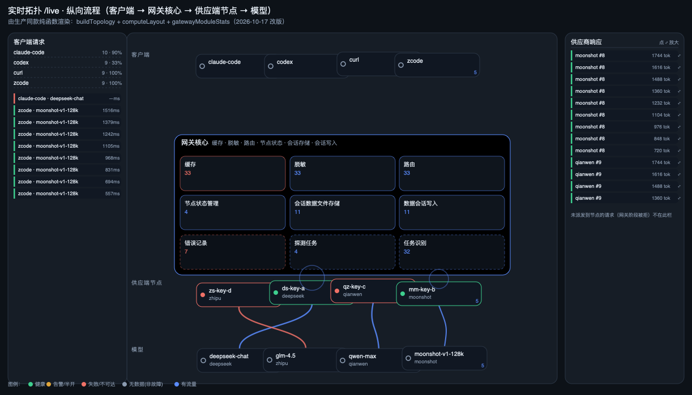

# 实时拓扑首页（Live Topology Home）设计方案

> 状态：设计已冻结，待实现（2026-10-16）
> 需求来源：维护者会话需求原文 —— 学习 `~/workspace/ai-native-tools/omarchy/network-switch`
> 的服务拓扑图，做一个**动态实时请求流拓扑**：客户端 → 本地路由 → 供应端节点 → 模型，
> 左→右或上→下动态显示实时请求流，最右侧一条窄的请求流水，
> 全图与数据可按供应商/客户端/模型过滤，最左（或最右）显示各供应商**当天**请求与 token 统计，
> 内部路由与任务判断形象化表达，够炫够直观。
> **新首页与旧首页并存**（旧 `/dashboard` 完整保留）。

---

## 1. 目标与判定

### 1.1 功能目标

| # | 需求项 | 判定口径 |
|---|---|---|
| G1 | 拓扑实时显示请求流 | 打开页面 ≤3s 内出现流动粒子；新请求到达 ≤800ms 内出现在图上 |
| G2 | 四段链路可视化 | 客户端 → 网关核心 → 供应端节点 → 模型，四列固定布局，链路方向单一 |
| G3 | 最右侧窄条请求流水 | 宽度 ≤ 220px，纵向滚动，单条含模型/供应商/状态/延迟/耗时 |
| G4 | 按供应商/客户端/模型过滤 | 过滤后图上节点与粒子、左右侧栏数据**同时**收敛到同一子集 |
| G5 | 供应商当天请求 + token 统计 | 按天（本地时区）聚合，请求数/成功数/失败数/prompt·completion·cache·total token/成本 |
| G6 | 内部路由与任务判断形象化 | 路由判定（自动决策/拦截原因/回退/重试/凭据切换）在图上以可见形态表达，非纯日志文字 |
| G7 | 新首页 + 旧首页并存 | 新页面独立路由与导航项；`/dashboard` 行为、tab、URL 契约零变更 |
| G8 | 够炫够直观 | 60fps 目标；暗色为主视觉；节点/链路状态一眼可辨；不牺牲可读性 |

### 1.2 非目标（本期不做）

- 不做历史回放 / 时间旅行（只做"当下 + 当天统计"）。
- 不做拓扑的拖拽布局持久化（network-switch 有，本期用固定分层布局，避免与过滤冲突）。
- 不替换、不改写既有 `LiveRequestStreamV2` 泳道页（`/dashboard?tab=stream` 保持原样）。
- 不做写操作（拓扑页只读；点击节点跳转到既有详情页/抽屉）。

---

## 2. 现状盘点：能复用什么（决定本方案的成本）

### 2.1 参考实现（network-switch）

| 借鉴点 | 位置 | 我们的取舍 |
|---|---|---|
| `Node{Kind,Label,Online,MS,Detail,X,Y}` / `Edge{From,To,OK,MS,Probe}` 模型 | `internal/topo/topo.go` | **沿用**（加 `Kind` 语义列、`Weight`、`Metric`） |
| SVG + 指针拖拽 + 坐标持久化 | `internal/assets/web/console.html:2043 drawTopo` | 拖拽**不采纳**（与过滤/自动布局冲突），SVG 分层思路**采纳** |
| `probe=false` 画中性线而非红断线 | 同上 `class="tedge idle"` | **采纳**：未探测 ≠ 故障（与本仓 r1014 类教训一致） |
| 环形兜底布局（无坐标时） | `console.html:2046` | **采纳为降级**：过滤后节点数变化时保持稳定排布 |

### 2.2 本仓已有数据面（决定后端几乎不用动）

| 需求 | 现有资产 | 证据 |
|---|---|---|
| 实时请求事件 | SSE `GET /api/admin/live-stream`，帧类型 `request` / `request_lifecycle` / `child_request` | `admin/live_stream_sse.go:1041`、`admin/live_stream_sse.go:55-80` |
| 请求字段（够画链路） | `provider_code`、`model`、`canonical_name`、`status`、`latency_ms`、三类 token、`cost_usd`、`error_kind`、`failure_stage`、`agent_name/client_profile/client_protocol/identity_hash`、`credential_id/label`、`parent_request_id/request_type` | `admin/live_stream_sse.go:335-391` |
| 供应端节点健康 | SSE `node_update` → `LiveNodeStatus`：`circuit_state/availability_state/quota_state/health_status/in_flight/last_latency_ms/fp_disabled/raw_models` | `web/src/composables/liveStreamStore.ts:207-232` |
| 内部路由/任务判断 | SSE `request_lifecycle` → `ActionEvent{action, stage, stage_category: routing|llm|retrying|terminal, auto_decision, blocked_reasons[], retry_seq, from/to credential & model, reason, ttfb_ms, queue_depth}` | `liveStreamStore.ts:78-108` |
| 内部队列/调度 | SSE `queue_snapshot` → `LiveQueueSnapshot{pipeline:{depth,inFlight,waitingMsP50/P95,degraded}, models[], credentials[]}` | `liveStreamStore.ts:177-205` |
| 泳道聚合（供应商/原厂/模型/凭据） | `LiveStreamSnapshot.dimensions` / `dimension_legends` / `status_legends` | `liveStreamStore.ts:156-163` |
| 静态拓扑骨架（模型↔凭据↔供应商） | `GET /api/routing/model-tree` → `series→generations→variants(canonical_name)→credentials[]`（含 available/circuit/quota/success_rate/p95/raw_model_name） | `web/src/api/routing.ts:317-343` |
| 供应商清单（code/display/health） | `GET /api/providers` | `web/src/api/providers.ts:18-56` |
| 单例 SSE 连接（多组件共享） | `useLiveStream()` / `liveStreamStore.ts`，`acquire()`/`release()` 引用计数 | `liveStreamStore.ts:266-410` |

### 2.3 缺口（唯一需要新增的后端能力）

**G5 当天供应商统计**：现有 `/api/admin/stats/breakdown?dimension=provider` 返回的是
`provider_id::text`（裸 ID，无 code/名称），且落在 `stats_usage_daily` 上——
该表由 `domains/stats/daily_monthly_rollup.go` **每小时**重建（`defaultRollupInterval = 1h`），
"当天"数字最多滞后 1 小时，且看板左栏要显示供应商名。

→ 新增 **`GET /api/admin/topology/providers-today`**（详见 §6），
沿用 `stats_usage_daily` 口径（与看板/账单同源，不引入第二套真值），
并在 UI 上标注数据水位 `source_high_watermark`，把"≤1h 滞后"显式化而不是假装实时。

---

## 3. 信息架构

> **2026-10-17 改版**：流程由左→右改为**上→下**；网关内部模块收进**一个大方块**；
> 左右两栏改为「客户端请求」/「供应商响应」；顶部过滤扩为四维**多选**。
> 下面是改版后的版面。

```
┌───────────────────────────────────────────────────────────────────────────────────────────┐
│ ① 顶部条：标题 │ 连接状态 │ Redis │ 四维多选过滤：                                       │
│    客户端 ▾  供应商 ▾  模型 ▾  节点 ▾   状态 ▾  时间窗(5m/30m/2h)        [清空过滤]        │
├──────────────┬────────────────────────────────────────────┬──────────────────────────────┤
│ ② 左栏       │ ③ 主拓扑画布（上→下，Canvas 动画层 + DOM 层）│ ④ 右栏                       │
│ 客户端请求   │                                            │ 供应商端响应                 │
│ ┌──────────┐ │        客户端                             │ ┌──────────────────────────┐ │
│ │claude-code│ │   ● claude-code  ● codex  ● curl           │ │ 12:03:41 deepseek #7   ⤢ │ │
│ │ 34 · 97% │ │        ╲   │   ╱  │   ╱                     │ │ glm-4.5 · 900 tok · 1.2s │ │
│ └──────────┘ │         ╲  │  ╱   │  ╱                       │ ├──────────────────────────┤ │
│  逐条请求    │      ══════▼═▼═══▼══▼══════                  │ │ 12:03:39 moonshot #8   ⤢ │ │
│ ┌──────────┐ │   ┌───────────────────────────────┐         │ └──────────────────────────┘ │
│ │12:03:41  │ │   │ 网关核心                      │         │   点 ⤢ → 内联放大面板       │
│ │glm-4.5   │ │   │ 缓存  脱敏  路由              │         └──────────────────────────────┤
│ │deepseek  │ │   │ 节点状态管理  会话数据文件存储 │  ← 供应端节点 ──── ds-key-a ● ds-key-b │
│ └──────────┘ │   │ 数据会话写入  错误记录 探测任务│         ──── qz-key-c  扎  mm-key-e     │
│ ┌──────────┐ │   │ 任务识别  （后三格 = 旁路虚线）│                               │
│ │12:03:39  │ │   └───────────────────────────────┘                ──── 模型 ────  │
│ └──────────┘ │                                                     glm-4.5 · kimi · qwen │
├──────────────┴────────────────────────────────────────────┴──────────────────────────────┤
│ ⑤ 左下：供应商当天统计（UTC 日桶 + 水位）   │ ⑥ 底部：选中请求的路由判定时间线              │
└───────────────────────────────────────────────────────────────────────────────────────────┘
```

- **层 = 语义分段**（不是自由布局）：`client` → `gateway`（大方块） → `provider`（凭据） → `model`，
  **自上而下**。
- **网关核心是**一个大方块**，不是一个小圆点。内部 3×3 九个模块按处理顺序排布：
  缓存 → 脱敏 → 路由 → 节点状态管理 → 会话数据文件存储 → 数据会话写入
  → 错误记录 → 探测任务 → 任务识别。
  - 前六个是**主链路**（实线边框）：每条请求都要过；
  - 后三个是**旁路**（虚线边框 + 降透明度）：命中才走，不是流水线的一步。
    画成实线会让人误读成「每个请求依次走完九步」。
  - 每格显示窗口内命中数；**没有数据就是 0 且画成 idle**，不编数字。
- **链路 = 一次请求的旅程**。同一请求在图上是**一颗有身份的粒子**：
  颜色 = 状态，描边 = 是否探测流量（`is_probe`），粗细 = 该链路窗口内请求数
  （对数映射），飞行时长 = 该段实际耗时。
- **左栏**：客户端请求摘要 = 按客户端聚合（请求数 / 成功率 / 在途 / 主要模型）
  + 这些客户端的逐条请求；点条目定位到图上并高亮其完整链路。
  **网关阶段就被拒（从未派发到供应端）的请求也在此栏** —— 客户端确实发了。
- **右栏**：供应商端响应。**只含有供应端节点的请求** —— 供应商没收到的就不该出现在这里。
  点 ⤢ 打开**内联放大面板**（不用 el-dialog/el-drawer：弹层会遮挡拓扑，
  且本仓 ui-audit 对弹层有形态契约）。
- **左下（G5）**：当天每供应商请求数 / token / 成本，顶部合计与**数据水位**
  （UTC 日桶，聚合表每小时重建，水位可能滞后 ≤1h —— 显式标注，不伪装成实时）。
- **底部抽屉（G6）**：选中请求后的**判定时间线**：鉴权 → 排队 → 自动决策 →
  选中凭据 → 尝试 → 失败原因 → 回退/重试 → 终态。

---

## 4. 拓扑模型与视觉语义

### 4.1 节点

```ts
interface TopoNode {
  id: string            // 稳定 id：client:<agent|profile>  gateway:core  cred:<credential_id>  model:<canonical|raw>
  column: 'client' | 'gateway' | 'provider' | 'model'
  label: string         // 展示名（客户端：agent_name || client_profile || identity_hash 前 8 位）
  sub?: string          // 次要信息（凭据：provider_code · #ID；模型：raw_model_name 数量）
  // 实时态（来自 node_update / request）
  health?: 'healthy' | 'warning' | 'down' | 'unknown'
  circuit?: string      // circuit_state 原值（不翻译语义，只做配色）
  quota?: string
  inFlight?: number
  lastLatencyMs?: number
  metric?: {            // 过滤窗内的聚合（由前端按 SSE 事件滚动聚合）
    requests: number; success: number; failure: number
    tokens: number; p95LatencyMs?: number
  }
}
```

**状态配色**（只用设计令牌，暗色下自动反转）：

| 语义 | 令牌 | 用途 |
|---|---|---|
| 成功/健康 | `--kx-success` | 成功粒子、健康节点环 |
| 进行中 | `--kx-primary` | 在途粒子、网关核心脉冲 |
| 告警（配额/慢/熔断半开） | `--kx-warning` | warning 节点、限流粒子 |
| 失败/熔断/不可用 | `--kx-danger` | 失败粒子、down 节点、链路断点 |
| 无数据/未探测 | `--kx-muted` + 虚线 | **未探测 ≠ 故障**（承 network-switch `probe=false` 教训） |
| 探测流量 | 虚线描边 | `is_probe=true` 不与真实业务流量混为一谈 |

### 4.2 边

```ts
interface TopoEdge {
  from: string; to: string
  qps: number          // 过滤窗内计数（对数映射粗细）
  lastStatus?: LiveStatus
  latencyMs?: number   // 该段最近一次实测
}
```

- 边默认中性灰细线；**有流量时才按状态着色**（避免"没流量=红色"的误读）。
- 多条并行请求共用一条边（并发合并），粒子只是沿边运动的视觉个体。
- `gateway → provider` 边的粗细承载"当前在途数（inFlight）"，可一眼看出哪个供应端在承压。

### 4.3 布局算法（确定性、可复算）

- **四层自上而下**（2026-10-17 改版，原为左→右）：每层有固定的高度占比中心线
  `client .09 / gateway .50 / provider .74 / model .93`，层内节点按
  `metric.requests` 降序取 Top N（默认 8/—/8/6）+ `「其他 N」` 聚合节点。
- **网关层不是一个节点**，而是一整块 `GatewayCoreBox` 几何
  （`computeGatewayBox`）：横向 78%、纵向 40%，内部 3×3 九格。
  两条硬约束写在布局函数里而不是靠 CSS 碰运气：
  1. **标题带**：大方块顶部有「网关核心 · 缓存·脱敏…」标题（组件里是正常流的
     `.gw__head`），网格必须为它预留 ≥24px，否则第一行模块被标题压住；
  2. **节点卡净空**：大方块底边要让开供应端节点卡的**上沿**
     （`rowY.provider - NODE_H/2`），而不只是中心线。
     净空 = 比例量 − 固定像素量，**随画布高度变化**，所以判据要扫多个高度。
- 层内 y 按名次等分 + 轻微抖动（确定性伪随机，按 id 哈希，**不用 `Math.random()`**，
  否则每次刷新节点乱跳，无法形成肌肉记忆）。
- 每 1s 重算一次布局；位置变化用 400ms ease-in-out 过渡（节点位置动画 + 粒子跟随重算轨迹）。
- 过滤变化 → 布局重算 + 粒子按新路径重投；不做"淡出等待"，避免拖沓。

---

## 5. 实时动画实现

### 5.1 分层渲染（关键决策）

| 层 | 技术 | 内容 | 帧成本 |
|---|---|---|---|
| 动画层 | **Canvas 2D**（`devicePixelRatio` 感知） | 链路曲线、流动粒子、节点光环、辉光 | 每帧重绘，预算 ≤6ms |
| 结构层 | **SVG** | 链路底纹（虚线/静态标签）、坐标层、命中区（比 Canvas 好做无障碍与文本） | 仅布局变化时重绘 |
| 交互层 | **DOM 覆盖层** | 节点卡片（标题/计数/状态点）、tooltip、图例、筛选态 | Vue 响应式，节流到 5Hz |

> 为什么不是 ECharts：`graph` series 每帧重建节点代价高、样式受主题约束；
> Canvas 自绘可控且与仓库现有 `--kx-*` 令牌一致。ECharts 仍用于左栏占比条之外的
> 复杂图表（如后续的热力图），本期不引入新依赖。

### 5.2 动画细节（"炫"的具体落点）

1. **流动基底**：每条有流量的边画一条沿路径的低透明度"流光带"
   （`lineDashOffset` 递减），静态无流量的边保持静止虚线。
2. **请求粒子**：每次 `request`/`request_lifecycle` 事件生成一颗粒子，
   按状态着色、大小按 token 量（对数）分 3 档；到达终点时节点环闪一次并衰减。
3. **网关核心呼吸**：核心节点有基础呼吸环 + 排队深度越高环越大（queue_snapshot 驱动）。
4. **拥塞可视化**：`inFlight` 超阈值的供应端节点显示琥珀色脉冲警示。
5. **失败闪断**：失败请求的粒子在终点变红并短暂显示 ✕ 标记后消散（不弹窗打扰）。
6. **hover 高亮**：悬停节点 → 该节点相关链路提亮、其余降到 12% 不透明度
   （"聚光"效果），并显示 tooltip：计数/成功率/token/最近延迟。
7. **降级与克制**：
   - `prefers-reduced-motion: reduce` → 关闭流光带与呼吸，粒子改为静态位置标记 + 数字计数；
   - 粒子总数硬上限 **240**（超出按最旧丢弃，页头显示"已聚合 N/s"）；
   - 页面不可见（`document.hidden`）→ 暂停 rAF；
   - 粒子运动时间基准用 `performance.now()` 差值，不用帧数（掉帧不改变速度）。

### 5.3 性能预算

| 指标 | 预算 | 手段 |
|---|---|---|
| 帧率 | ≥55fps（1440p、M 系列） | Canvas 分层、粒子上限、避免每帧创建对象（粒子池） |
| 单帧 JS | ≤6ms | 对象池 + 预计算路径（节点移动时才失效） |
| 布局重算 | ≤4ms | N 上限 23 个节点，纯函数，可测 |
| SSE 事件处理 | ≤1ms/事件 | 增量聚合，不在事件回调里做布局 |
| 首屏 | ≤3s 出现流动粒子 | model-tree + providers 并行拉取，SSE 首帧即渲染 |

---

## 6. 数据契约

### 6.1 新增：`GET /api/admin/topology/providers-today`

```
GET /api/admin/topology/providers-today
200 {
  "day_start": "2026-10-16T00:00:00+08:00",
  "generated_at": "...",
  "source_high_watermark": "...",     // 数据水位，显式暴露 rollup 滞后
  "totals": { "requests": 0, "success": 0, "failure": 0,
              "prompt_tokens": 0, "completion_tokens": 0,
              "cache_read_tokens": 0, "cache_write_tokens": 0,
              "total_tokens": 0, "cost_usd": 0 },
  "items": [ { "provider_id": 12, "catalog_code": "deepseek",
                "display_name": "DeepSeek", "enabled": true,
                "health_status": "healthy",
                "requests": 0, "success": 0, "failure": 0, "rate_limited": 0,
                "prompt_tokens": 0, "completion_tokens": 0,
                "cache_read_tokens": 0, "cache_write_tokens": 0,
                "total_tokens": 0, "credits_charged": 0, "cost_usd": 0,
                "share": 0.42 } ]
}
```

- **口径**：`stats_usage_daily`，`dimension_type='provider'`，
  `day_utc = (now at 租户时区)::date`；provider id 关联 `providers` 取 code/名称/健康。
- **租户隔离**：`statsTenantScope(r)`（与 `/api/admin/stats/*` 同一 helper），
  租户管理员只能看到自己租户；缺 `tenant_id` 参数时按会话身份取，禁止"无参=全量"。
- **角色门控**：注册在 `admin(...)` 中间件之后（管理员及以上），与 live-stream 同级。
- **失败语义**：DB 不可用返回 503 + `degraded=true` 信封，左栏显式显示"统计不可用"，
  **不渲染成零行**（对齐本仓 2026-10-03 抽屉降级教训）。
- **契约测试**：`admin/topology_providers_today_test.go`
  —— 租户过滤断言（另一租户数据不可见）、参数缺失不返回全量、降级信封形状、SQL 维表常量。

### 6.2 复用：`GET /api/admin/live-stream`（SSE）

前端通过既有 `useLiveStream()` 取：
`requestsRef` / `nodesRef` / `queueRef` / `actionsRef` / `snapshotRef` / `connectionRef`。

**过滤在客户端做**，不下推到 SSE（原因：SSE 是全局广播，
按客户端过滤会破坏"超级管理员看全局、租户看自己"的既有租户模型，
且下推需要为每个客户端单独算，收益低于成本）。
过滤只影响"图 + 左右侧栏"的呈现；右上角明确标注
"图上为过滤后视图，全局数据仍在 `/dashboard?tab=stream`"。

### 6.3 复用：`GET /api/routing/model-tree`

拉取一次（进入页面 + 每 5min 或手动刷新），产出静态骨架：
`模型 → 变体 → 凭据（供应端节点）` 的可路由关系与静态健康字段。
与实时 `node_update` 合并：静态给"有哪些边"，实时给"现在好不好"。

---

## 7. 过滤设计

> **2026-10-17 改版**：四个维度全部改为**多选**（原为单选）。

| 过滤器 | 取值来源 | 作用范围 |
|---|---|---|
| 客户端 | `agent_name` ∪ `client_profile` ∪ `client_protocol`（近窗聚合，Top 12） | 图、左右两栏、左下统计同步收敛 |
| 供应商 | `providers` ∪ 近窗出现过的 `provider_code`（Top 12） | 同上；供应端节点按**凭据**画，供应商作为分组语义 |
| 模型 | `canonical_name` ∪ `raw_model_name`（Top 12） | 模型层收敛 + 边收敛 |
| 节点 | 近窗出现过的供应端节点 id（`cred:<id>`，Top 12） | 比供应商**更严**的一档：只保留选中凭据的请求 |
| 状态 | 成功 / 进行中 / 失败 / 限流 | 只过滤请求与粒子，**不影响**节点健康着色，否则会误读为节点坏了 |
| 时间窗 | 5m / 30m / 2h（默认 5m） | 窗口外数据不参与边粗细、节点计数与网关模块统计 |

- **多选语义**（写在 `liveTopologyFilter.ts` 顶部注释，且必须有对应判据）：
  - **同维度内 OR**：客户端选了 A、B，命中其一即保留；
  - **跨维度 AND**：各维都命中才保留；
  - **空选 = 该维不过滤**。
  语义漂移的症状是「图上少了一半、右栏又多一半」，很难自查。
- 过滤器状态入 URL query，多选用**逗号分隔串**（`?provider=a,b&client=c`），
  可分享、可刷新恢复，与既有 `?tab=` 契约不冲突。
- 每个选项显示「当前命中数」，避免"图空了不知道为什么"；
  「过滤后为空」与「真的没流量」必须是两句话，不共用一条空态。
- **收敛铁律**：图、左栏、右栏、左下统计读**同一个** `filteredRequests`。
  各栏各算各的，用户就会看到「图里没有、右栏却有」的自相矛盾画面。

---

## 8. 接入：路由与导航（G7 的落地）

- 新路由 `path: '/live'`（`meta: { requiresAuth: true }`），组件 `LiveTopologyView.vue`。
- `web/src/config/appNav.ts` 在 `/dashboard`（总览）**之前**插入新项
  `{ path: '/live', label: '实时拓扑', labelKey: 'nav.item.liveTopology', icon: '🛰' }`。
- `/dashboard`、`/dashboard?tab=stream`、`HomeView`、`DashboardView(V2)` **一行不改**。
- 未登录访问 `/live` → 走既有登录/维护平台跳转逻辑（与 `/dashboard` 同）。
- 租户管理员进入 `/live` → 自动按租户作用域过滤，页头显示当前租户标识。

---

## 9. 可访问性与降级

| 场景 | 行为 |
|---|---|
| `prefers-reduced-motion` | 关流光/呼吸，粒子改静态标记 + 计数（信息不丢） |
| 窄屏（<1280px） | 左栏折叠为顶部抽屉；右栏窄条保留但只显示 6 条 + "展开" |
| 手机（<768px） | 降级为**单列纵向流水**（客户端→模型 折叠成阶段标签行），不做横向画布 |
| SSE 断开 | 顶部横幅 + 自动重连状态；图保留最后快照并整体降饱和，**不假装还在实时** |
| Redis 异常 | 显示 `redis_error` 文案；节点健康退化为 unknown（中性灰），不误报故障 |
| 无数据 | 骨架 + "等待第一帧"（区分"连接中"与"已连接但无流量"——承 r1032 教训） |
| 颜色 | 状态不仅靠颜色：形状（虚线/实线）+ 文字 + 图例三重编码（色觉友好） |
| 键盘 | 节点可 Tab 聚焦、`Enter` 打开详情；筛选器键盘可达 |

---

## 10. 测试与验收

### 10.1 前端单测（vitest，与仓库现有 spec 同风格）

| 文件 | 判据 |
|---|---|
| `LiveTopologyView.filters.test.ts` | 过滤后节点/边/侧栏三者**同时**收敛；URL query 往返一致 |
| `topologyLayout.test.ts` | 布局确定性（同输入同输出，不用 `Math.random`）；Top N 截断 + 「其他」节点；`probe=false` 不判故障 |
| `topologyFlow.test.ts` | 粒子生命周期：事件 → 生成 → 到达 → 消亡；粒子上限 240 生效；`document.hidden` 暂停 |
| `providersTodayRail.test.ts` | 降级信封渲染为"统计不可用"而非零行；token 数字口径正确 |
| 突变验证 | 把 `filter()` 改成恒真 ⇒ 过滤测试必须红；把布局改成 `Math.random` ⇒ 确定性测试必须红 |

### 10.2 后端单测

- `admin/topology_providers_today_test.go`：租户隔离、降级信封、参数缺失语义。
- 复用 `tests/` 既有契约门；新增端点进 `verify.sh` 的 handler 清单（若有清单文件）。

### 10.3 人工验收矩阵（本地 host-first 部署实测）

1. 首页进 `/live` ≤3s 出现流动粒子；发一条真实请求 800ms 内上图。
2. 右栏窄条出现该请求；点它 → 图上粒子高亮 + 底部判定时间线展开。
3. 按供应商过滤 → 图/左栏/右栏同步收敛，计数与过滤命中数一致。
4. 杀掉网关 → 顶部断线横幅 + 图降饱和，**不出现假实时**。
5. `prefers-reduced-motion` 模拟 → 无动画但信息完整。
6. 租户管理员登录 → 左栏只见本租户数据。

### 10.4 构建门

`web/` 必须全绿：`ui:check:strict`、`i18n:check`、`color:check`、`responsive:check`、
`vue-tsc --noEmit`、`vitest run`；`go build ./... && go vet ./admin/...`。

---

## 11. 分片实施（每片独立可验收）

| 片 | 内容 | 验收 |
|---|---|---|
| **S1** | 后端 `providers-today` 端点 + 单测 + 契约 | 单测红绿正确；租户隔离断言有牙 |
| **S2** | 前端骨架：路由/导航/空画布/i18n/降级 | 构建门全绿；页面可达且空态正确 |
| **S3** | 拓扑画布：布局 + Canvas 动画层 + 交互层 + 过滤 | 性能预算达标；单测+突变验证 |
| **S4** | 左栏当天统计 + 右栏请求窄条 + 底部判定时间线 | 人工验收矩阵 1-3、6 通过 |
| **S5** | 降级/可访问性/移动端 + 文档与交接 | 验收矩阵 4-5 通过；AGENTS.md 更新 |

---

## 12. 风险与对策

| 风险 | 影响 | 对策 |
|---|---|---|
| `stats_usage_daily` 滞后 ≤1h | 左栏"当天"数字不是秒级 | 显式展示数据水位；SSE 增量只做"近 5m"提示，不与当天口径混算 |
| 节点/边数量爆炸（615 模型） | 布局与渲染卡顿 | 每列 Top N + 「其他」聚合节点；模型列默认按"近窗有流量"排序 |
| SSE 事件突发（几百/秒） | 主线程卡顿 | 事件批量入队 + rAF 内消费；聚合 map 增量更新；粒子上限硬顶 |
| 与既有泳道页功能重叠 | 维护双份实时渲染 | 明确分工：泳道页=精确逐条；拓扑页=态势。共用 store，不复制逻辑 |
| 审计门（i18n/颜色/响应式/卡片覆盖）红 | 构建失败 | 每个组件按现有规范落；先跑 `ui:check:strict` 再写样式 |

---

## 13. 实现落点（2026-10-16 首版落地，2026-10-17 改版）

| 层 | 文件 |
|---|---|
| 后端端点 | `admin/topology_providers_today.go`（路由注册在 `admin/handler.go`，走既有 `admin(...)` 中间件） |
| 后端判据 | `admin/topology_providers_today_test.go`（7 条：租户隔离 / 降级信封 / 未知桶 / SQL 契约钉子 / UTC 日桶口径） |
| 前端类型 | `web/src/types/liveTopology.ts`（`GATEWAY_MODULES` 九模块 + `GatewayCoreBox` + 多选 `TopoFilters`） |
| 纯函数 | `web/src/lib/liveTopologyGraph.ts`（构图）、`liveTopologyLayout.ts`（纵向布局 + 网关大方块几何）、`liveTopologyFilter.ts`（多选过滤 / 四维候选 / 网关模块统计）、`liveTopologyParticles.ts`（粒子池） |
| 编排 | `web/src/composables/useLiveTopology.ts`（图 / 左栏 / 右栏 / 网关统计共用同一过滤子集） |
| 网关核心 | `components/live-topology/GatewayCoreBox.vue` + `GatewayCoreBox.test.ts` |
| 左右面板 | `ClientRequestPanel.vue`、`ProviderResponsePanel.vue`、`RequestZoomPanel.vue` + `RequestPanels.test.ts` |
| 当天统计 | `ProviderTodayRail.vue`（左下，UTC 日桶 + 水位）+ `ProviderTodayRail.test.ts` |
| 判定时间线 | `RoutingDecisionTimeline.vue`（底部）+ 放大面板内复用同一批 `ActionEvent` |
| 画布 | `components/live-topology/TopologyCanvas.vue`（Canvas 链路/粒子 + DOM 节点卡 + 嵌入网关大方块） |
| 视图 | `web/src/views/LiveTopologyView.vue`（路由 `/live`）+ `LiveTopologyView.filters.test.ts`（14 条）+ `LiveTopologyPreview.vue`（DEV 夹具预览） |
| i18n | `web/src/locales/{zh-CN,zh-TW,en-US,ja-JP,de-DE,es-ES,fr-FR,ar-SA}/liveTopology.ts`（8 个 locale 全覆盖，含 gateway / panel / zoom 三组新键） |
| 导航 | `web/src/config/appNav.ts` —— `/live` 置于「总览」之前；`/` 与 `/dashboard` 一行未改 |

**改版删除**：`RequestStreamStrip.vue`（右侧窄条流水）已被
`ClientRequestPanel` + `ProviderResponsePanel` 取代，连同 `liveTopology.strip.*`
三个 i18n 键一并移除。`RoutingDecisionTimeline.vue` 保留（底部判定时间线仍是
「路由判断形象化」的常驻入口）。

### 13.1 与方案的偏差（已落地并写明理由）

1. **当天 = UTC 日桶**，不是本地日。`stats_usage_daily.day_utc` 就是 UTC 日，
   强行按本地日切会让 +08:00 的「今天 00:00」跨到两个 UTC 日桶而无法精确切分。
   响应里带 `day_utc` + `source_high_watermark`，左栏**显式标注**水位，
   不把 ≤1h 滞后的数字伪装成实时（G5 的诚实性要求）。
2. **供应端列按凭据画，供应商作为分组语义**（2026-10-16 拍板）：node_update 本来就是
   凭据级（熔断/配额/在途/延迟），凭据级节点才能指出「哪一把 key 坏了」。
   过滤下拉同时提供「供应商整体」与「单把凭据（`code #id`）」两种口径。
3. **不接 `/api/routing/model-tree` 做静态骨架**（方案 §6.3 原列）：首版的边全部由
   实时请求推导 —— 画「当下正在走的链路」不需要静态骨架，反而省掉一次重查询。
   等需要展示「当前可路由但此刻没流量」的模型时再接。

### 13.2 本轮新增的两条判据纪律（值得写进经验库）

1. **pgxmock 不执行 SQL ⇒ 行级判据对 SQL 形态改动是假绿。**
   把 `LEFT JOIN providers` 改成 `JOIN providers`（未知供应商桶被静默丢弃），
   5 条行级判据**全绿**。必须另配一条**钉在 SQL 常量上的契约判据**
   （`TestProvidersTodaySQLContractPinsJoinAndTenantGuard`），变异验证确认它会红。
   凡「单测全绿 + 改坏 SQL 不红」的组合，都是这类漏网。
2. **mock 夹具要写全真实形状**：初版 rail 夹具只给了 `totals` 的两个字段，
   vue-tsc 直接报类型错。半截信封在真实接口里不会出现，
   用它写夹具等于让组件在一组线上不存在的输入上被测。

### 13.3 2026-10-17 改版的三条判据纪律

1. **「规则恒真」是假绿的头号来源。**
   右面板「只含有供应端节点的请求」这条规则，在夹具里三条请求都带凭据时
   **恒为真** —— 删掉整个过滤逻辑，全部判据依然全绿（变异验证 M8 实测）。
   补了一条**网关阶段就被拒、从未派发**的夹具，并同时钉住两件事：
   它出现在左栏（客户端确实发了）、不出现在右栏（供应商没收到）。
   凡有「排除某类」的规则，夹具里就必须有一条**恰好命中该排除条件**的样本。
2. **判据的输入参数要选能区分的那一组，不是能跑的那一组。**
   网关大方块压住供应端节点卡 2px 这条真缺陷，判据只按「中心线」断言时是绿的；
   更巧的是旧比例 `hRatio=0.42` 在 `height=700` 下**恰好正好相接**，
   只有换到 `height=620` 才暴露压了 2px。净空是「比例量 − 固定像素量」，
   随画布高度变化，所以判据扫了 `[480,620,700,900,1200]` 五个高度。
3. **肉眼验收要盯「渲染物」，不是盯「代码」。**
   本轮大方块的两个真缺陷（标题压住第一行模块、底边压住节点卡）都是靠
   **重新生成布局快照并逐格核对**发现的 —— 单测全绿时它们已经存在。
   判据只能证明「我想到的」不变量，证明不了「我没想到的」重叠。

---

## 14. 布局快照（设计评审用）



`assets/live-topology-layout-snapshot.svg` 由**生产同款纯函数**
（`liveTopologyGraph.buildTopology` + `liveTopologyLayout.computeLayout` +
`liveTopologyFilter.gatewayModuleStats`）渲染，不是手画示意图 ——
层位、九宫格几何、Top N 截断、边粗细（在途压力环、健康描边、
失败链路红色）、网关九模块命中数都来自真实代码路径。图中可见：

- **上→下四层**：客户端 → 网关核心大方块 → 供应端凭据 → 模型；
- **网关核心是一整块**，标题带 + 3×3 九格；末行三格（错误记录 / 探测任务 /
  任务识别）是**虚线旁路**，不会被读成串行九步；
- 节点卡底部空心圆 = `unknown`（**没有数据，不是故障**）；
  `qz-key-c` 琥珀描边 = 熔断半开/配额低；`zs-key-d` 红描边 = 熔断打开不可达；
- 红链路 = 该段窗口内有失败；蓝色 = 有流量但无失败；
- 左栏含一条 `—ms` 的条目（网关阶段被拒，无时延数据）与右栏的排除说明。

⚠️ 这张图只证明**布局与配色语义**。动效（流光、粒子、脉冲）、真实登录态下的
交互与帧率**没有**运行时证据 —— 见 AGENTS.md「剩余任务」第 8 条
（沙箱里连仓库既有 DEV 页都卡在登录态检测，浏览器肉眼验收未做）。

---

## 15. 交接

- 本页实现完成后，在 `AGENTS.md`「已完成」追加一条，并更新 `web/src/config/appNav.ts`
  注释说明两个首页的分工。
- 相关文档：本文件（方案）+ 实现后补的 `docs/05-testing/` 验收记录。
