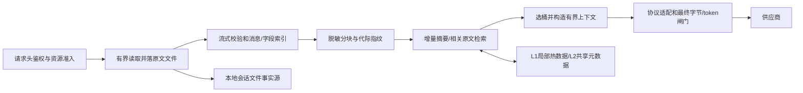

# 100MB 请求接入、会话文件化与桶级上下文预算方案

日期：2026-11-09（Asia/Shanghai）。审查基线：`9801786a62663842e160caa0fe87c931e81a0644`。本轮为方案与可行性审查，未改变运行代码、生产配置或数据库。用户已明确单位：入口 **100MB**；发往供应商的输入通常最多 **500K tokens**，同时不超过该桶模型上下文的 **50%**。本方案建议配置使用精确整数：入口 `100000000 bytes`、输入 `500000 tokens`，避免 MB/MiB 混用。
## 1. 审查结论与选择

**可行，但必须把处理链改为文件与引用驱动，不能只调大入口常量。** 接入容量、供应商上下文与内存预算是三个独立约束。100MB 接入不等于保证任意内容都能在一次500K-token调用中完整处理；语义压缩有损，精确全量任务需要另行提供分块执行模式或明确拒绝。

| 路线 | 能做到什么 | 代价与判断 |
| --- | --- | --- |
| 只统一入口上限、继续整包解析 | 部分路径可以接收100MB | 原文、脱敏、IR、摘要与日志可能同时占堆；不能满足内存目标，否决 |
| **文件事实源＋有界解析＋增量压缩＋桶级发送闸门** | 保留原文、限制活跃内存、沿用既有缓存及压缩资产 | 需要逐段替换整包接口；推荐主线 |
| 独立上传API＋异步分块任务 | 适合首次导入巨型资料、逐字核查、超长处理 | 需显式任务API/客户端配合；作为后续能力，不假装与普通同步聊天透明等价 |

50%是本项目的运营策略，并非供应商共同规定。500K是通常上限而非固定目标；短会话直接使用较小输入。若将来允许例外，必须由管理侧桶策略显式版本化授权，客户端不能自行放宽。

## 2. 当前代码事实与可复用资产

| 位置 | 本轮核查事实 | 设计含义 |
| --- | --- | --- |
| `cmd/gateway/main_pipeline.go:684,700,803,1110` | V2 dispatch 包装路径上限32MiB；整包ReadAll、恢复Body并解析model/stream；deps缺失时可回退直连handler | 统一所有入口与别名的限额及接线，不能把源码常量当成现网生效证据 |
| `security/sanitize/smart_sani_guard.go:45,201,2130`；`domains/streaming/handler.go:73,2713` | 脱敏和handler各有128MiB上限，并读取完整正文 | 调大dispatch后仍有整包内存成本；鉴权、准入必须先于大体积落盘/解析 |
| `deploy/nginx/active-20261027/llmgo.kxpms.cn.conf:56` | 仓内一份Nginx配置为256m | 仅为部署文件证据；CDN、各域名、实际nginx -T与运行版本还需部署轮验证 |
| `storage/file/bodies_store.go:104,118,167` | 已有`tenant/shard/session/turn_N`目录及原子写；Write先Marshal再压缩，Read先ReadFile再整体解压 | 复用目录与生命周期，扩展Reader/Writer/分块引用接口；现状不满足有界内存 |
| `storage/file/codec.go:76,145,158` | 已有gzip/zstd，主要是EncodeAll/DecodeAll | 算法可复用，流式/独立帧接口需补；lite工厂默认zstd，full热区构造仍默认gzip，不混为一谈 |
| `storage/file/async_writer.go:25,35` | 队列默认1000项，任务持有Data []byte | 改为排队文件引用＋按字节准入，避免大对象在队列中积压 |
| `domains/session/v2/cache_v2.go:155`；`cache_v2_file.go` | V2 L1/L1.5主要保存压缩和治理元数据 | 元数据缓存直接复用；不能误称已归档100MB原文 |
| `domains/hooks/compression/session_cache.go:65`；`session_cache_shared.go:238` | V1 L1已有256MiB聚合预算；共享层会压缩并保存outbound正文 | 保留租约、revision和代际机制；增加单项预算，禁止原文作为巨大Redis值 |
| `domains/session/v2/outbound_builder.go:52,130` | 历史构建仍返回完整消息数组/[]byte；部分模式可从全部delta重建 | 冷恢复也须以摘要边界＋分页增量为起点，不能读回全部历史 |
| `domains/hooks/compression/compressor.go:158`；`window.go:68` | 已有lite、caveman、toolfocused、机械裁剪、LLM摘要；窗口默认80%，另有200K/400K提示/强压缩档 | 保留策略实现，统一预算来源；触发阈值不等于发送硬上限 |
| `session_compressor.go:838,858` | 一条摘要路径会先抽完整会话，再按900K-token估值裁剪 | 摘要调用本身也要执行500K/50%约束，不能先把大输入交给摘要模型 |
| `domains/streaming/handler.go:4210,4231,4281` | 会话Prepare排除native Responses；取候选最小已知窗口；NeverWorse后还恢复tools、注入及转换 | 逐协议覆盖；最终闸门必须在恢复工具及全部转换之后 |
| `provider/client.go:176` | ContextWindow已支持binding override＞canonical override＞base | 沿用优先级，再补输入/输出/字节/计数器及规格版本，不另建互相冲突的限额来源 |

已有RAW→SANITIZED→COMPACTED、占位符generation、消息指纹、cut marker、alignment/provenance应保留。`internal/requestarchive`是请求事实生命周期归档，`RequestMirror`是best-effort镜像，均不能直接替代“接收时原文必须可靠落盘”的新职责。

## 3. 两道发送预算与一道资源预算

对每个具体桶`b`（凭据×模型×端点/协议及有效规格版本）解析：总窗口`C_b`、最大输入`I_b`、输出/思考保留`O_b`、计数误差与协议余量`S_b`、供应商/代理解码后字节上限`V_b`。

```text
T_input(b) = min(500000, floor(0.50 × C_b), I_b, C_b - O_b - S_b)
B_json(b)  = min(网关上游JSON字节策略, 当前端点及代理的已验证字节上限)
放行条件  = 完整模型可见上下文tokens ≤ T_input(b)
          且 最终适配完成JSON实际bytes ≤ B_json(b)
```

不存在的独立`I_b`项不参与min，但`C_b`未知不能当无限。上下文只登记“input limit”的模型须标注规格语义，不能冒充total window。输出与thinking依据具体API计入同一窗口时只计一次；输出请求超过桶能力时明确报错，不静默改变用户参数。任何算得≤0的预算均不可路由。

| 实际登记的C_b | 50%后的通常输入上限（尚需其它项收紧） |
| --- | --- |
| 128000 | 64000 tokens |
| 256000 | 128000 tokens |
| 1000000 | 500000 tokens |
| 2000000 | 仍为500000 tokens |

system、工具schema、历史、当前输入、检索片段、协议注入、多模态与远端状态均参与计数。原有bytes/3.5只能作触发估算，不能证明硬限制。优先使用对应模型的受支持tokenizer/计数器；计数能力不足时以验证过的保守上界准入，否则剔除该桶。远端count-tokens调用也受自身发送字节与输入约束，不能把100MB未处理原文送去“先数一遍”。

最终JSON字节默认值应由桶清单和真实语料选定；**500K tokens不等于500KB**。未知供应商字节规格在严格模式下不得接大请求；若有运营核准的保守默认，必须标记来源和适用端点。可以另用例如8MiB的网关字节上限进行资源实验，但它是待验参数，不能写成供应商规格。

## 4. 目标数据流与本地会话目录



入口按实际读入字节限制100000000，不依赖Content-Length；chunked、少报长度也不能绕过。第一版可只接受identity编码；如支持gzip等输入，必须同时限制传输量、解码量、解码窗口/CPU，100MB业务限额按解码后正文执行。上传总期限与闲置读超时分别配置。原文“精确字节”指HTTP transfer decoding及受支持Content-Encoding解码后的业务正文，另保留编码元数据；不承诺复原TCP报文。

建议在既有session目录下新增版本化子目录，避免破坏turn_N存量读取器：

```text
<session_root>/<tenant>/<shard>/<session>/large-v1/
  manifest.json                 # 有界根清单；历史引用/frames按页保存
  requests/<request_id>/raw-*    # 原始请求及响应，分帧压缩/加密
  chunks/<opaque_id>.*           # 脱敏内容/工具结果/附件；可定位独立帧
  index/<revision>.*             # 分页消息索引、关联ID和字段位置
  summaries/<revision>.*         # 结构化摘要及来源引用
  outbound/<attempt_id>.*        # 实际发送体或其引用、hash和预算凭据
```

原始请求快照用于精确审计，归一化会话chunk用于增量复用；后续客户端全历史重放可按同租户内容块去重，不能只凭session_id认为前缀相同。供应商原始响应与最终客户端响应也按权限分开流式归档，沿用响应合规及占位符还原时序，不增加全响应缓冲。原文文件、索引、manifest分开：分块写临时文件→Close编解码器→校验长度/hash→fsync文件→原子提交→按平台支持同步父目录→提交manifest。RAW由服务端生成唯一ID并采用不可覆盖创建；普通覆盖式rename不能独自证明不可变。同会话提交串行化或执行revision CAS＋fencing，磁盘manifest提交也验证版本；Redis CAS不能代替文件提交协调。manifest只引用已提交文件，接受并转发前至少确认本轮RAW已提交；失败尝试不能把未成功的分支推进为会话主revision。语法错误/中途取消的临时数据按短保留期清理。

根manifest限定大小，历史清单/引用分页；重启恢复、hash校验、引用遍历及孤儿GC同样分页/流式处理，不能恢复时再把整个会话索引读入堆。GC只删除超过保护期、无manifest引用且无在途lease的块，并与revision提交协调。

RAW不是可淘汰缓存。它的保留期、租户配额、删除和恢复承诺独立于HotZoneTrimmer；在途lease、未完成任务和仍被引用的块不得清理。新增子目录若复用热区根，必须先修订trimmer受管范围，不能默认它会保护新事实源。

权限默认目录0700、原文文件0600；推荐受管磁盘加密或分块AEAD。后者须有独立nonce、块完整性与密钥轮换方案；不可为图方便先留长期明文tmp。原文可能包含秘密，不复制进普通日志、Redis、搜索索引。只允许可信租户/会话定位，防路径和symlink逃逸，所有读回执行租户鉴权。

## 5. 怎样保证内存只有局部内容

1. 入口只用固定大小读写缓冲（建议64–256KiB），边计数、hash边落盘；不保留raw []byte或完整string。鉴权后立即申请上传/磁盘配额，等待队列只保存引用；未知长度按最大请求预留空间，再按实用量结算。
2. 使用能跳过/分片读取巨大字符串的JSON词法扫描器，完整验证对象、数组、UTF-8及转义，提取model/stream和消息索引。字段顺序不固定，model在末尾也必须可处理。拒绝重复的关键字段/歧义形状，限制深度、字段数、消息数与索引页大小。
3. 单条100MB字符串、base64或tool结果也要流式外置，不能只做到“每消息Decode”。`json.Decoder.Decode(&wholeRequest)`仍整值缓冲，`Token()`也会物化完整字符串。[Go官方源码](https://go.dev/src/encoding/json/stream.go)
4. 不构造完整历史IR；IR只覆盖本轮将发送的有界上下文。压缩器、脱敏器、日志、WAL、请求事实、durable任务、队列和缓存均传`BodyRef＋长度＋hash＋revision`；保留小对象兼容适配器，并设明确物化上限，超限不可退回旧整包路径。
5. 有界解析还包括脱敏字典和索引：分页/磁盘化，限制驻留条目与单字段大小。跨块私钥/凭据不能靠固定重叠窗口假装完整识别；已支持模式实现状态机或有界字段重组，无法流式等价处理的规则/不透明签名块明确拒绝该大请求，不能跳过检测。generation及字面占位符预留通过首遍索引/二遍分块处理保留。
6. gzip/zstd以流或独立帧写入，配置编码/解码window和并发。随机读必须有frame→offset映射，不能给普通gzip加一个offset就声称可seek，也不能每次解压整个100MB来取末尾。codec池、sync.Pool与取消后的缓冲回收都计入全局预算。
7. 队列、响应采集和异步持久化均执行字节额度，排队项持文件引用。即使摘要结果较小，也不允许每个策略并行复制整包候选；使用顺序升级或受限并发，小候选按引用共享。

目标内存复杂度为`O(固定IO缓冲＋索引页＋有界摘要/检索片段＋有界最终上下文)`，不随RAW大小线性增长。CPU与磁盘IO至少仍为O(输入大小)，读取100MB不能变成零成本。

## 6. 多算法压缩与保真边界

| 顺序 | 策略与复用方式 | 保护规则 |
| --- | --- | --- |
| 0 | 同generation、同revision命中已有摘要/出站结果；仅处理新增/修改区间 | 校验消息hash、工具关联和历史编辑，不能仅按轮次追加 |
| 1 | 无语义损失的JSON紧凑编码、合法去重、稳定前缀 | 不改内容字符串中的空白、代码、签名、提示词优先级；JSON少字节不一定少token |
| 2 | 复用toolfocused，对旧文件/grep/shell/JSON结果提取局部结构；lite/caveman按任务启用 | 这是可能有损的变换，保留原文引用；不改待执行arguments、工具schema和当前工具调用对 |
| 3 | 按完整turn/tool依赖组管理关联；巨大content叶子按字节/token预算分片，局部摘要后恢复关联并分层合并 | 不先物化100MB依赖组；无法安全分片则明确失败；每次摘要调用也过桶预算，保留任务、约束、决定、未解决项、路径/数字及来源 |
| 4 | 稳定摘要＋最新完整工作集＋与当前任务相关的原文片段 | 从脱敏语料检索，租户隔离，限定top-k和总预算；原文片段保留出处，不提升为system指令 |
| 5 | 若仍超限，减少可选旧片段或标记桶不可用 | 禁止静默截断最新任务、system、安全约束、未完成工具链、签名thinking |

原文经脱敏后才可进入摘要模型。摘要不是“无损压缩”；字符串相等、数字/路径/引用完整、工具链闭合等确定性检查可以做门禁，但LLM自评分不能证明语义完全保留。必须靠任务样本比较正确率；精确全量提取、逐字diff/法律条文全量核查等需求不能依赖检索top-k或摘要保证完成。

边界例子：最新用户消息本身超过T_input，或system＋tools＋未完成工具链已经超预算，不能删旧历史解决。返回明确`context_budget_exceeded`（建议422，遵循既有协议错误信封），指明预算和可采取的分块方式，不能向供应商发超限请求。显式分块任务可多次处理全部材料，但会增加总token、调用数、成本和延迟；每次调用仍受同一规则约束。

## 7. 与原多层缓存结合

不要重命名原有L1/L2/L3导致语义混乱：RAW/SANITIZED/COMPACTED是内容阶段，L1/L1.5/L2/L3是存储层次，本地不可变原文是事实源，三者分别建模。

| 层 | 存放内容 | 失效/回源 |
| --- | --- | --- |
| L1进程 | 有界摘要、最近工作集、索引页、小型出站结果 | 聚合字节预算＋单项预算＋TTL；不存RAW |
| L1.5本地元数据 | 已有V2文件缓存与轻量引用 | 继续可淘汰，不承担RAW唯一副本 |
| L2 Redis | revision、generation、租约、预算profile、摘要/片段引用；只容许受限小值 | CAS/fencing防并发覆盖，不能因Redis失效加载全RAW进内存 |
| L3数据库 | 会话/请求元数据、引用、审计和现有历史兼容投影 | 大请求RAW新增路径不再内联完整正文；查询面显示可用性与位置 |
| 本地会话文件 | 原文、脱敏chunk、分页索引、摘要和实际出站记录 | 按引用和显式保留期管理；冷读按页/帧读取 |

缓存键至少覆盖tenant、session、source revision/hash、sanitization generation、算法/提示词版本、协议、预算profile/规格版本及tokenizer版本。源内容/脱敏代际变化时失效；不能用更大预算下的成品直接喂给更小桶。结构化事实摘要可在同权限/代际内复用，最终出站成品按预算分别缓存。

provider prompt cache只优化供应商计算，不表示它认识本地hash，也不消除窗口占用。[OpenAI官方缓存说明](https://developers.openai.com/api/docs/guides/prompt-caching) 显式remote cache或previous_response_id仅在对应API支持时作为增强：引用绑定provider/account/model/endpoint，计入远端历史token；TTL到期、换桶需从本地有界重建。缓存建立和刷新请求同样不能绕过发送预算。

## 8. 路由、最终闸门与故障

先生成共享事实摘要/索引和受保护工作集，以预算能力筛选候选，再按实际候选构建上下文；避免无关的小窗口候选把所有请求提前裁成最小上下文。无法容纳必需内容的桶因容量不匹配被排除，不写成供应商健康失败/断路状态。

最后闸门位于每次HTTP发送之前：恢复tools、system注入、模型改名、跨协议转换、参数修正全部结束→计算实际字节与目标计数→生成绑定`body_hash＋bucket_spec_version＋budget`的不可变凭据→发送。计数之后不得再改正文；失败重试、流式/非流式、Chat/Responses/Anthropic/Gemini及摘要客户端都覆盖。NeverWorse的退回原文和4xx恢复不能绕过此闸门。

| 情况 | 规定行为 |
| --- | --- |
| 接入实际正文>100MB | 413，删除未提交临时文件，不调用供应商 |
| 上传/处理额度不足 | 请求体读取前尽量返回429＋Retry-After；不在内存里排队100MB正文 |
| 磁盘满、权限/提交失败 | 503（或内部存储错误码），不假装已接收，不退化为RAW常驻内存 |
| JSON非法、深度/结构不支持 | 400/明确协议错误，不发无效截断JSON |
| 脱敏失败/代际不一致 | 拒绝或重新有界处理，不能原文透传摘要模型 |
| 缓存失败 | 本地索引/摘要有界回源；必需引用缺失则明确不可恢复 |
| 摘要失败/超时/费用超限 | 仅在保留必需内容且仍符合预算时用已有结果；否则明确失败 |
| 换至小窗口桶 | 重新基于文件源构建该桶成品并验证，不能直接重用大桶body |
| 客户端取消/进程重启 | 取消摘要/处理，释放lease/FD；保留已提交RAW；清理孤儿和未提交temp |
| 蓝绿切换/换主机 | 第一版保证同宿主持久卷且两槽可读；BodyRef含存储owner/位置。跨主机亲和失效且无可达回源/副本时明确不可恢复；复制/远端回源独立验收后再扩大保证范围 |

若响应已预先发送200/SSE心跳，则后续错误只能使用该协议的终态错误，不能声称还能返回HTTP422/503。应尽量在基本格式、落盘及预算可满足性确认后才开始SSE，流前准备超时与网关/客户端超时要一起验收。首次100MB导入可能需要很多摘要调用，不承诺普通聊天级首字延迟。

## 9. 资源容量模型与验收目标

以下是**初始设计目标，尚未做新链路压测**。500K tokens对应的字节数依模型/内容变化，不能据此把单请求内存目标固定为500KB。

```text
进程资源 = 业务基线 + L1总预算 + 上传并发×上传缓冲
         + 活跃压缩并发×工作集额度 + 日志/响应/codec/索引额度 + 安全余量
磁盘写入速率 = 请求数/秒 × 平均新增RAW字节 × 写放大系数
```

建议先以每个压缩worker **64MiB可控工作集**、每实例 **4个活跃worker**做实验；最终JSON另设独立字节上限，有界候选用完即释放。超预算时减少并发/片段，不能继续分配到OOM。该额度不是Go进程RSS的硬上限，GC、codec、TCP、OS page cache和cgroup file memory要同时观测；GOMEMLIMIT仅作辅助，不替代准入。

用算术看风险：100MB×20个并发已有2GB原文，尚未计解析副本；4×64MiB worker仅是256MiB工作集额度，也未包含服务基线。磁盘按无压缩收益预留：RAW、脱敏派生及临时帧可能约需3倍输入空间；是否能取更小系数须按实际保留组合测定，绝不预设zstd必缩小。若每秒持续接入1个100MB完整新请求，仅RAW即 **8.64TB/日**；必须有租户配额、重放去重、明确保留期及容量告警，不能靠定时删缓存解决。

每请求限制摘要调用数、总输入/输出token、耗时、重试次数及费用；初始建议最多8次在线摘要/合并调用、达到总时限即停止，结果不足则提示异步分块。该建议在首次100MB任务上可能明显不足，需要通过语料决定；不可为追求“必压到500K”而无限递归调用。

## 10. 实施分段、验证与回滚

本方案是设计与可行性文件，不是已经批准执行的逐行施工脚本。实施按依赖推进，每段形成独立小提交与可回滚开关。

| 阶段 | 主要文件/职责 | 必须拿出的验收证据 |
| --- | --- | --- |
| A 桶预算与发送闸门 | `provider/client.go`及能力投影；`domains/hooks/compression`预算解析；`domains/streaming/executors`和摘要HTTP出口 | 128K/256K/1M窗口、未知规格、输出预留、工具恢复后超限、换桶、所有协议和摘要路径；上游mock实际收到的body证明无一次越界 |
| B 文件引用和流式存储 | `storage/interfaces.go`、`storage/file`；元数据/日志/durable任务BodyRef适配 | RAW精确roundtrip；gzip/zstd新旧兼容；commit前崩溃、ENOSPC、取消、租户隔离及不存在引用；不重复内联100MB |
| C 有界接入与解析 | `main_pipeline.go`、`request_meta.go`、`security/sanitize`和新增分块扫描模块 | 100MB边界±1、chunked、model在末尾、单条巨型字符串/附件、转义与重复字段；heap/FD/temp上界与取消释放 |
| D 增量语义与缓存 | `session_compressor.go`、策略runner、V2 outbound/turn reader、Redis及文件缓存 | 跨轮重放、历史编辑、工具完整性、generation切换、摘要失败、小窗口降级；不得全历史回源 |
| E 集成、容量和上线 | 实际CDN/Nginx/蓝绿持久卷、HotZoneTrimmer、真实供应商与统计投影 | 1/10/100MB×1/4/16并发，冷/热缓存、重启/换槽/换主机；RSS/heap/file-memory/IO/首字/成本和任务正确率 |

新链路核心验收：①每个供应商物理调用均满足token与字节预算；②10MB→100MB在相同出站预算下，活跃工作集不随RAW线性增加；③RAW不可变可恢复、原始hash一致；④最新任务、系统约束、工具调用语义保持；⑤资源拒绝、恢复失败和压缩损失可观察。质量样本覆盖中文、英文、代码、数字、反复引用旧事实、复杂工具链、多模态与精确全量任务，不能只测易压缩重复字符串。

本轮已运行基线命令`go test ./storage/file ./domains/hooks/compression ./domains/session/v2`，三包均exit 0（分别9.391s/11.591s/5.055s，Go1.27.2 darwin/arm64）。这只验证复用资产的现有测试，不证明新100MB路径、实际供应商、100MB RSS或生产接线已验收。

上线顺序：先影子计算预算→开启最终闸门及小流量有界路径→验证文件持久性与资源准入→最后统一放开100MB。回滚先关闭100MB大请求接入、停止新任务，等待/取消在途，再切旧处理器；保留文件和引用读取器，不能删除事实源。新文件双读兼容到保留期结束；最终发送闸门应保留。所有开关名及一行回滚命令在实施轮确定并实测，本轮没有可执行部署变更。

## 11. 复审记录与尚需实证的点

两轮自审修正：单位不明、落盘与有界解析混同、摘要/工具恢复后预算遗漏、缓存免发送误判、V2元数据与RAW混同、单条消息/字典/索引无界、GC误删、输出窗口语义及目标被当作实测等问题。独立复核再补：RAW不可覆盖与磁盘manifest并发提交、恢复/GC分页、巨大依赖组的content分片、同宿主与跨主机恢复保证分层。以上已纳入正文。

当前仍需实施实证：真实桶完整规格与token计数覆盖、语义压缩质量、100MB首次导入成本/延迟、全链路物化点清零、运行拓扑与本地卷恢复能力。技术路线可执行，不代表这些指标已经满足。官方资料及API差异见[配套证据](2026-11-09-large-request-vendor-evidence.md)。
